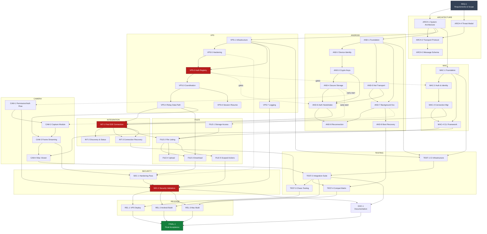

# PhoneLink — Complete Development DAG & Project-Management Specification

*Personal authorized remote-access system: Android ⇄ VPS relay ⇄ Mac. Planning artifact only — no application code. Companion file: `project_graph.json` (machine-readable, validated).*

**Graph stats (computed and validated, not estimated):** 49 nodes · 1 root (`REQ-1`) · 2 leaves (`FINAL-1`, `VPS-8`) · 0 cycles · every node reachable from root · critical path = 13 edges / 14 nodes.

## Table of Contents
1. [Executive Overview](#1-executive-overview)
2. [Level-1 DAG](#2-level-1-dag)
3. [Complete Node List](#3-complete-node-list)
4. [Detailed Node Specifications](#4-detailed-node-specifications)
5. [Dependency Table](#5-dependency-table)
6. [Parallel-Development Groups](#6-parallel-development-groups)
7. [Critical Path](#7-critical-path)
8. [Integration Points](#8-integration-points)
9. [Risk / Dependency Analysis](#9-risk--dependency-analysis)
10. [Mermaid Level-1 DAG](#10-mermaid-level-1-dag)
11. [Mermaid Critical-Path DAG](#11-mermaid-critical-path-dag)
12. [project_graph.json](#12-project_graphjson)
13. [Linear-Ready Issue List](#13-linear-ready-issue-list)
14. [Node Completion Protocol](#14-node-completion-protocol)
15. [Recommended Implementation Order](#15-recommended-implementation-order)
16. [Questions / Ambiguities to Resolve Before Coding](#16-questions--ambiguities-to-resolve-before-coding)

---

## 1. Executive Overview

PhoneLink is a three-component personal remote-access system: an Android app, a Mac client, and a VPS that relays encrypted traffic between them so the two devices can reach each other regardless of NAT/network. The system's defining constraint isn't features — file access and camera viewing are both well-understood problems — it's that every feature has to be built **inside** Android's permission, foreground-service, and background-execution model rather than around it, and the VPS has to be a low-trust relay rather than a data store.

That constraint shapes the whole DAG in two ways:

- **A threat model (`ARCH-4`) sits at Level 1, immediately after scope**, not bolted on at the end. It gates device identity, crypto, the VPS auth registry, camera authorization, and the remote-action system directly — the abuse-case analysis it produces (what does *not-consensual* use of this system look like, and what does the design do to structurally prevent it) is a first-class dependency of those nodes, not a footnote.
- **Camera and file access are separate Level-1 verticals**, not sub-tasks of Android. Both need coordinated work across Android, VPS, and Mac, and both can start their Android-only groundwork (`FILE-1`, `CAM-1`) as soon as secure storage exists — well before the three components ever talk to each other.

The graph has 49 nodes: 1 requirements node, 4 architecture nodes, 9 Android, 8 VPS, 4 Mac, 3 integration, 5 files, 4 camera, 2 security, 4 testing, 3 release, 1 documentation, 1 final acceptance. The critical path is 14 nodes long and — perhaps counterintuitively — runs mostly through **Android's identity/crypto/storage chain**, not through the VPS or Mac tracks, even though all three platform tracks are roughly the same depth. Section 7 explains why.

The single most important structural fact in this DAG: **`INT-1` (first end-to-end encrypted connection) is a hard convergence point.** Nothing in Files, Camera, or later Testing can be verified as actually working until Android auth, VPS relay, and Mac connection management are all independently complete. Three parallel teams can build toward that point; nobody can prove the system works before it.

---

## 2. Level-1 DAG

```
PhoneLink
 │
 ├─ Requirements               (REQ-1)
 │
 ├─ Architecture                (ARCH-1, ARCH-4, ARCH-2, ARCH-3)
 │
 ├─ Android                     (AND-1 … AND-9)
 ├─ VPS                         (VPS-1 … VPS-8)
 ├─ Mac                         (MAC-1 … MAC-4)
 │
 ├─ Integration                 (INT-1, INT-2, INT-3)
 ├─ Files                       (FILE-1 … FILE-5)
 ├─ Camera                      (CAM-1 … CAM-4)
 │
 ├─ Security                    (SEC-1, SEC-2)
 ├─ Testing                     (TEST-1 … TEST-4)
 │
 ├─ Release                     (REL-1, REL-2, REL-3)
 ├─ Documentation                (DOC-1)
 │
 └─ Final Acceptance             (FINAL-1)
```

Rationale for deviating from the brief's sketch: **Files and Camera are Level-1, not sub-nodes of Android**, because both require coordinated Android + VPS + Mac + protocol work — filing them under Android would misrepresent their real dependency footprint. **Integration is Level-1 and sits between the platform tracks and the feature verticals**, because `INT-1` is a genuine standalone milestone (first proof the whole system works), not an artifact of any one platform's work.

---

## 3. Complete Node List

Sorted by computed dependency level (topological depth from `REQ-1`).

| ID | Name | Category | Priority | Depends On | Blocks |
|---|---|---|---|---|---|
| REQ-1 | Requirements, Scope & Threat Boundary | Requirements | P0 | — | ARCH-1, ARCH-4 |
| ARCH-1 | High-Level System Architecture | Architecture | P0 | REQ-1 | ARCH-2, AND-1, VPS-1, MAC-1 |
| ARCH-4 | Threat Model & Abuse-Case Analysis | Architecture | P0 | REQ-1 | ARCH-2, AND-2, AND-3, VPS-2, FILE-1, FILE-5, CAM-1 |
| AND-1 | Android Project Foundation | Android | P0 | ARCH-1 | AND-2, AND-5, AND-7, TEST-1 |
| ARCH-2 | Transport & Session Protocol Design | Architecture | P0 | ARCH-1, ARCH-4 | ARCH-3, AND-5, VPS-3, MAC-2 |
| MAC-1 | Mac Client Project Foundation | Mac | P0 | ARCH-1 | MAC-2, MAC-4, TEST-1 |
| VPS-1 | VPS Base Infrastructure & Deployment Skeleton | VPS | P0 | ARCH-1 | VPS-5, VPS-2, VPS-7, TEST-1 |
| AND-2 | Android Device Identity Provisioning | Android | P1 | AND-1, ARCH-4 | AND-3 |
| AND-5 | Android Core Network Transport Layer | Android | P1 | AND-1, ARCH-2 | AND-6, AND-7 |
| ARCH-3 | Application Message Schema & API Contract | Architecture | P1 | ARCH-2 | VPS-4, FILE-2, CAM-3 |
| TEST-1 | Test Infrastructure & CI Pipeline | Testing | P1 | AND-1, VPS-1, MAC-1 | TEST-2 |
| VPS-5 | VPS Platform Security Hardening | VPS | P1 | VPS-1 | VPS-2, SEC-1 |
| VPS-7 | VPS Logging & Monitoring | VPS | P2 | VPS-1 | SEC-2, REL-1 |
| AND-3 | Android Cryptographic Key Management | Android | P1 | AND-2, ARCH-4 | AND-4, AND-6 |
| AND-7 | Android Background Execution & Foreground Service | Android | P1 | AND-1, AND-5 | AND-8, AND-9, CAM-2 |
| VPS-2 | VPS Device Authentication & Identity Registry | VPS | P0 | VPS-1, VPS-5, ARCH-4 | AND-6, VPS-3, MAC-2 |
| AND-4 | Android Secure Local Storage | Android | P1 | AND-3 | AND-6, FILE-1, CAM-1 |
| AND-9 | Android Boot-Persistence & Reboot Recovery | Android | P2 | AND-7 | TEST-4 |
| MAC-2 | Mac Authentication & Identity | Mac | P1 | MAC-1, ARCH-2, VPS-2 | MAC-3 |
| VPS-3 | VPS Session Coordination & Signaling | VPS | P1 | VPS-2, ARCH-2 | VPS-4, VPS-6 |
| AND-6 | Android Authentication Handshake | Android | P0 | AND-3, AND-4, AND-5, VPS-2 | AND-8, INT-1 |
| CAM-1 | Camera Permission & Explicit Activation Authorization Flow | Camera | P1 | ARCH-4, AND-4 | CAM-2, SEC-2 |
| FILE-1 | Android Storage Access Layer | Files | P1 | AND-4, ARCH-4 | FILE-2 |
| MAC-3 | Mac Connection Manager | Mac | P0 | MAC-2 | MAC-4, INT-1, INT-3 |
| VPS-4 | VPS Relay Data Path | VPS | P0 | VPS-3, ARCH-3 | VPS-8, INT-1, FILE-3, FILE-4, CAM-3 |
| VPS-6 | VPS Session Resumption & Reconnection Handling | VPS | P2 | VPS-3 | INT-3 |
| AND-8 | Android Reconnection & Network-Change Handling | Android | P2 | AND-6, AND-7 | INT-3 |
| CAM-2 | Android Camera Capture Module | Camera | P1 | CAM-1, AND-7 | CAM-3 |
| INT-1 | First End-to-End Encrypted Connection | Integration | P0 | AND-6, VPS-4, MAC-3 | INT-2, INT-3, FILE-2, SEC-1 |
| MAC-4 | Mac CLI Command Framework | Mac | P1 | MAC-1, MAC-3 | FILE-2, CAM-4 |
| VPS-8 | VPS Direct-Connection Optimization (Optional) | VPS | P3 | VPS-4 | — |
| CAM-3 | Camera Frame Streaming Protocol & Transport | Camera | P1 | CAM-2, VPS-4, ARCH-3 | CAM-4, SEC-1 |
| FILE-2 | Remote File Listing | Files | P1 | FILE-1, ARCH-3, INT-1, MAC-4 | FILE-3, FILE-4, FILE-5 |
| INT-2 | Device Discovery & Status Reporting | Integration | P2 | INT-1 | TEST-2 |
| INT-3 | End-to-End Connection Recovery | Integration | P2 | AND-8, VPS-6, MAC-3, INT-1 | TEST-3 |
| CAM-4 | Mac Camera Viewer Client | Camera | P1 | CAM-3, MAC-4 | TEST-2 |
| FILE-3 | Secure File Download | Files | P1 | FILE-2, VPS-4 | SEC-1, TEST-2 |
| FILE-4 | Secure File Upload | Files | P1 | FILE-2, VPS-4 | SEC-1, TEST-2 |
| FILE-5 | Scoped Remote Action System | Files | P2 | FILE-2, ARCH-4 | SEC-2, TEST-2 |
| SEC-1 | Cross-Component Security Hardening Pass | Security | P1 | INT-1, FILE-3, FILE-4, CAM-3, VPS-5 | SEC-2 |
| TEST-2 | Cross-Component Integration Test Suite | Testing | P1 | TEST-1, INT-2, FILE-3, FILE-4, FILE-5, CAM-4 | TEST-3, TEST-4, REL-3, DOC-1 |
| SEC-2 | Security Validation & Penetration Testing | Security | P0 | SEC-1, VPS-7, CAM-1, FILE-5 | REL-1, REL-2, REL-3, DOC-1 |
| TEST-3 | Network Failure & Chaos Testing | Testing | P2 | TEST-2, INT-3 | REL-1 |
| TEST-4 | Android Compatibility Matrix Testing | Testing | P2 | TEST-2, AND-9 | REL-2 |
| DOC-1 | Consolidated Documentation & Setup Guide | Documentation | P2 | SEC-2, TEST-2 | FINAL-1 |
| REL-1 | VPS Production Deployment | Release | P1 | SEC-2, TEST-3, VPS-7 | FINAL-1 |
| REL-2 | Android Release Build & Signing | Release | P1 | SEC-2, TEST-4 | FINAL-1 |
| REL-3 | Mac Release Build & Packaging | Release | P1 | SEC-2, TEST-2 | FINAL-1 |
| FINAL-1 | Final Acceptance Testing & Release Readiness | Final Acceptance | P0 | REL-1, REL-2, REL-3, DOC-1 | — |

---

## 4. Detailed Node Specifications

Format per node: Purpose → Dependencies/Blocks/Parallelizable → Inputs/Outputs → Tasks → Acceptance Criteria → Tests → Failure Conditions → Security Considerations → Affected Components → Artifacts.

### 4.1 Requirements

#### `REQ-1` — Requirements, Scope & Threat Boundary
**Category:** Requirements · **Priority:** P0 · **Status:** PENDING

**Purpose:** Fix exactly what PhoneLink is and isn't before any design work starts — one Android phone, one Mac, one VPS, owned and operated by the same person, with an explicit no-covert-operation constraint.

**Dependencies:** none (root) · **Blocks:** ARCH-1, ARCH-4 · **Parallelizable:** No — sole starting point.

**Inputs:** The project brief itself (this conversation).
**Outputs:** A written requirements/scope document.

**Tasks:**
- Enumerate functional scope (connectivity, file access, camera) and explicit non-goals (no stealth/hidden mode, no bypassing OS permissions, single-owner unless later revised)
- Fix Android/macOS minimum-version targets and the VPS hosting model at a high level
- State the VPS data-retention policy in testable terms (what may never be persisted to disk)

**Acceptance Criteria:**
- Functional scope and explicit non-goals documented
- Device/OS version targets for Android, macOS, and VPS defined
- VPS data-retention policy stated in testable terms

**Tests:**
- Requirements doc reviewed against every area in the original brief
- Sign-off recorded before `ARCH-1` starts

**Failure Conditions:** Scope left ambiguous enough that two later nodes could reasonably implement contradictory behavior (e.g., one assuming multi-device support, another assuming single-device).

**Security Considerations:** This is where the "never bypass Android security/privacy restrictions" and "camera normally OFF" constraints become binding requirements rather than aspirations — they should be written as testable acceptance criteria here, not just prose.

**Affected Components:** Documentation
**Artifacts:** `REQUIREMENTS.md`

---

### 4.2 Architecture

#### `ARCH-1` — High-Level System Architecture
**Category:** Architecture · **Priority:** P0

**Purpose:** Produce the component diagram, data-flow diagram, and per-platform technology choices everything else builds on.

**Dependencies:** REQ-1 · **Blocks:** ARCH-2, AND-1, VPS-1, MAC-1 · **Parallelizable:** Yes — alongside `ARCH-4` (both only need REQ-1).

**Inputs:** REQ-1 requirements doc.
**Outputs:** Architecture document with component/data-flow diagrams and stack decisions.

**Tasks:**
- Draw component diagram (Android app, VPS relay, Mac client) and data-flow diagram for each major flow (auth, file transfer, camera)
- Choose per-platform stack (e.g., Kotlin/Android, Swift or cross-platform for Mac, a server runtime for VPS) — kept flexible below this level per the project's own design principle
- Define trust boundaries between components

**Acceptance Criteria:**
- Component and data-flow diagrams cover Android, VPS, Mac
- Every REQ-1 requirement traces to a component
- Technology stack per platform decided and justified

**Tests:**
- Architecture reviewed against REQ-1 checklist
- Diagram peer-reviewed for gaps

**Failure Conditions:** A requirement from REQ-1 has no corresponding component, or the data-flow diagram implies the VPS ever holds plaintext file/camera data at rest.

**Security Considerations:** This is the first point to decide, at least at a high level, that the VPS is a **relay**, not a **store** — that decision ripples through nearly every later node.

**Affected Components:** Documentation, Shared protocol
**Artifacts:** `ARCHITECTURE.md`, component diagram, data-flow diagrams

---

#### `ARCH-4` — Threat Model & Abuse-Case Analysis
**Category:** Architecture · **Priority:** P0

**Purpose:** Formally analyze what could go wrong — VPS compromise, device loss, replay/MITM, and critically, *what non-consensual use of this system would look like and what in the design structurally prevents it*. This node's output is a direct dependency of every privacy-sensitive node downstream.

**Dependencies:** REQ-1 · **Blocks:** ARCH-2, AND-2, AND-3, VPS-2, FILE-1, FILE-5, CAM-1 · **Parallelizable:** Yes — alongside `ARCH-1`.

**Inputs:** REQ-1 scope.
**Outputs:** Threat model document.

**Tasks:**
- Threat-model VPS compromise, lost/stolen device, replay/MITM/token-theft, and malicious or malformed relay traffic
- Explicitly analyze the abuse case "this app is used to monitor someone without their knowledge or consent" and derive concrete design constraints from it (no hidden UI/icon, mandatory foreground indicator whenever data is flowing, camera activation always requires a visible, OS-level indicator, no silent/background camera trigger)
- Map each threat to a mitigating node or an explicitly accepted risk

**Acceptance Criteria:**
- Threats covering VPS compromise, device loss, replay/MITM, unauthorized camera use documented
- Non-consensual-use abuse case analyzed with resulting design constraints
- Every threat has a mitigation or accepted-risk note

**Tests:**
- Threat list cross-checked against every later security-relevant node
- Abuse-case constraints traced into `CAM-1` and `FILE-5` specs specifically

**Failure Conditions:** A downstream security-relevant node (auth, camera, remote actions) is implemented without a corresponding entry in this threat model.

**Security Considerations:** This node's entire purpose *is* security consideration — it's the one place in the graph where "should this feature exist at all, and in what constrained form" gets decided deliberately rather than by default.

**Affected Components:** Documentation
**Artifacts:** `THREAT_MODEL.md`

---

#### `ARCH-2` — Transport & Session Protocol Design
**Category:** Architecture · **Priority:** P0

**Purpose:** Define how Android, VPS, and Mac actually talk — transport, encryption, and session establishment — before any networking code exists on any platform.

**Dependencies:** ARCH-1, ARCH-4 · **Blocks:** ARCH-3, AND-5, VPS-3, MAC-2 · **Parallelizable:** Yes — with early Android/VPS/Mac foundation work (`AND-1`, `VPS-1`, `MAC-1`), since those don't need the protocol finalized.

**Inputs:** ARCH-1 architecture, ARCH-4 threat model.
**Outputs:** Protocol specification with sequence diagrams.

**Tasks:**
- Choose transport/encryption approach (e.g., TLS 1.3/mTLS, or a purpose-built encrypted-framing protocol) with the explicit requirement that the VPS relays ciphertext it cannot read — true end-to-end encryption between Android and Mac, not VPS-terminated TLS
- Diagram the session-establishment handshake sequence
- Specify the key-exchange approach

**Acceptance Criteria:**
- Transport/encryption scheme defined (E2E, VPS relays ciphertext only)
- Session-establishment sequence diagrammed
- Key-exchange approach specified

**Tests:**
- Protocol spec self-reviewed against ARCH-4 threats
- Handshake sequence diagram completed

**Failure Conditions:** The chosen transport terminates encryption at the VPS (VPS can read plaintext) — this directly contradicts REQ-1's data-minimization requirement and must be caught here, not later.

**Security Considerations:** This is the single highest-leverage security decision in the whole project. Get the "VPS as ciphertext-only relay" property wrong here and no amount of later hardening (`SEC-1`/`SEC-2`) fully fixes it.

**Affected Components:** Documentation, Shared protocol
**Artifacts:** `PROTOCOL.md`, handshake sequence diagrams

---

#### `ARCH-3` — Application Message Schema & API Contract
**Category:** Architecture · **Priority:** P1

**Purpose:** Define the versioned message schema (auth, file ops, camera ops, status, errors) that Android, VPS, and Mac all implement against — the thing that makes independent client development actually converge.

**Dependencies:** ARCH-2 · **Blocks:** VPS-4, FILE-2, CAM-3 · **Parallelizable:** Yes — with `AND-2`…`AND-5`, `VPS-5`, `MAC-2` foundation work.

**Inputs:** ARCH-2 protocol design.
**Outputs:** Versioned message schema (e.g., protobuf or JSON Schema) and API contract doc.

**Tasks:**
- Define message types for auth, file listing/download/upload, camera control/frames, status/presence, and errors
- Define a versioning strategy so client and server can evolve independently
- Publish example messages for each type

**Acceptance Criteria:**
- Versioned schema for auth, file ops, camera ops, status, errors
- Backward-compatible versioning strategy defined

**Tests:**
- Schema validated with a linter
- Example messages round-trip in a test script

**Failure Conditions:** Android and Mac teams implement diverging interpretations of an ambiguous message field, discovered only at `INT-1`.

**Security Considerations:** Every field here should be considered adversarial input on receipt — this schema is what `SEC-1`'s input-validation work will be checked against.

**Affected Components:** Documentation, Shared protocol
**Artifacts:** `schema/` (message definitions), `API_CONTRACT.md`

---

### 4.3 Android

#### `AND-1` — Android Project Foundation
**Category:** Android · **Priority:** P0

**Purpose:** A buildable, CI-verified, empty Android app that every later Android node builds on.

**Dependencies:** ARCH-1 · **Blocks:** AND-2, AND-5, AND-7, TEST-1 · **Parallelizable:** Yes — with `VPS-1`, `MAC-1` (independent platform foundations).

**Inputs:** ARCH-1 stack decision.
**Outputs:** Buildable Android project skeleton.

**Tasks:** Scaffold Kotlin project; configure Gradle build; configure lint/static analysis; define module structure anticipating identity/crypto/network/storage/UI separation.

**Acceptance Criteria:** Project builds via CI · Lint/static analysis configured · Module structure supports later features.
**Tests:** `./gradlew build` succeeds in CI · Empty app launches on emulator.
**Failure Conditions:** Build isn't reproducible in CI (works only on one machine).
**Security Considerations:** None beyond enabling static analysis early.
**Affected Components:** Android, Tests
**Artifacts:** Android project repo skeleton, CI config

---

#### `AND-2` — Android Device Identity Provisioning
**Category:** Android · **Priority:** P1

**Purpose:** Give the device a stable identity the VPS and Mac can recognize across sessions.

**Dependencies:** AND-1, ARCH-4 · **Blocks:** AND-3 · **Parallelizable:** Yes — with `AND-5`, `AND-7`, and VPS/Mac foundation work.

**Inputs:** AND-1 scaffold, ARCH-4 threat model (identity-spoofing considerations).
**Outputs:** Device-identity module.

**Tasks:** Generate a Keystore-backed keypair on first launch; derive a stable device ID from it; persist across restarts; ensure reinstall generates a fresh identity rather than inheriting one.

**Acceptance Criteria:** Stable device ID tied to a Keystore-backed keypair generated on first launch · ID persists across restarts; reinstall yields a new identity.
**Tests:** Unit test — identity persists after process restart · Unit test — reinstall produces new identity.
**Failure Conditions:** Identity is derivable/spoofable without the private key (e.g., a plain random UUID unrelated to the keypair).
**Security Considerations:** Identity must be cryptographically bound to the keypair generated in `AND-3`, not just a convenience string — otherwise device authentication has nothing to actually verify.
**Affected Components:** Android, Tests
**Artifacts:** `DeviceIdentity` module

---

#### `AND-3` — Android Cryptographic Key Management
**Category:** Android · **Priority:** P1

**Purpose:** Hardware-backed (where available) key generation, storage, and signing — the foundation everything cryptographic on Android relies on.

**Dependencies:** AND-2, ARCH-4 · **Blocks:** AND-4, AND-6 · **Parallelizable:** Yes.

**Inputs:** AND-2 identity concept, ARCH-4 threat model.
**Outputs:** Keystore-backed key management module with a signing API.

**Tasks:** Generate/store keys in Android Keystore, using StrongBox/hardware backing where the device supports it; expose a signing operation for the auth handshake; ensure keys are never exportable in plaintext; consider key attestation.

**Acceptance Criteria:** Keys generated/stored in Android Keystore, hardware-backed where available · Keys never exportable in plaintext · Signing operation available for the auth handshake.
**Tests:** Unit test confirms non-exportability · Instrumented test — key survives app update.
**Failure Conditions:** Private key material is ever accessible outside the Keystore boundary (e.g., copied into app-controlled memory unnecessarily or logged).
**Security Considerations:** Prefer StrongBox-backed keys on devices that support it; verify current Keystore API guidance at implementation time, since hardware-backing availability varies by device.
**Affected Components:** Android, Tests
**Artifacts:** `KeyManager` module

---

#### `AND-4` — Android Secure Local Storage
**Category:** Android · **Priority:** P1

**Purpose:** Store session tokens and config without ever writing secrets in plaintext.

**Dependencies:** AND-3 · **Blocks:** AND-6, FILE-1, CAM-1 · **Parallelizable:** Yes — note this is the fork point where `FILE-1` and `CAM-1` can start immediately, well before networking/auth is done (see Section 6).

**Inputs:** AND-3 key management.
**Outputs:** Secure storage module.

**Tasks:** Implement encrypted storage (e.g., `EncryptedSharedPreferences` or equivalent) for tokens/config; audit logging paths to ensure no secret ever lands in plaintext logs.

**Acceptance Criteria:** Tokens/config stored via EncryptedSharedPreferences or equivalent · No secrets in plaintext logs or files.
**Tests:** Static scan finds no plaintext secret storage · Instrumented test — data unreadable outside app sandbox.
**Failure Conditions:** A debug log line ever prints a token or key material.
**Security Considerations:** This is a common real-world failure point (debug logging leaking secrets) — worth an explicit lint rule or CI check, not just a one-time audit.
**Affected Components:** Android, Tests
**Artifacts:** `SecureStorage` module

---

#### `AND-5` — Android Core Network Transport Layer
**Category:** Android · **Priority:** P1

**Purpose:** Establish and manage the TLS/mTLS (per `ARCH-2`) connection to the VPS.

**Dependencies:** AND-1, ARCH-2 · **Blocks:** AND-6, AND-7 · **Parallelizable:** Yes — with AND-2/3/4 (crypto/storage track is largely independent of networking).

**Inputs:** AND-1 scaffold, ARCH-2 protocol spec.
**Outputs:** Network transport client.

**Tasks:** Implement socket/QUIC client per `ARCH-2`; handle connect/disconnect/error events as explicit states; implement basic retry primitives (full reconnection logic is `AND-8`).

**Acceptance Criteria:** TLS/mTLS connection established to VPS · Connect/disconnect/error events handled cleanly.
**Tests:** Simulated connect success/TLS-failure/unreachable-server tests pass · State-transition unit tests pass.
**Failure Conditions:** Connection state machine has an unreachable or ambiguous state under error conditions.
**Security Considerations:** Certificate validation must not be weakened for testing convenience and left that way (a common source of real MITM vulnerabilities); flag any TLS-verification bypass as a hard blocker.
**Affected Components:** Android, Shared protocol, Tests
**Artifacts:** `NetworkTransport` module

---

#### `AND-6` — Android Authentication Handshake
**Category:** Android · **Priority:** P0 *(critical path)*

**Purpose:** Complete the client side of device authentication against the VPS — the node that turns "Android has keys and a connection" into "Android has a verified, authenticated session."

**Dependencies:** AND-3, AND-4, AND-5, VPS-2 · **Blocks:** AND-8, INT-1 · **Parallelizable:** Client-side logic can be developed against a mocked `VPS-2` in parallel with `VPS-2`'s own implementation, but this node cannot be marked COMPLETE until it passes against a real `VPS-2` instance.

**Inputs:** AND-3 signing capability, AND-4 token storage, AND-5 transport, a live VPS-2 endpoint.
**Outputs:** Authenticated session + client state machine.

**Tasks:** Implement client-side handshake per `ARCH-2`'s sequence; handle auth failure, expired-token, and clock-skew edge cases; store the resulting session token via `AND-4`.

**Acceptance Criteria:** Device completes handshake against a live VPS-2 instance · Bad credentials and expired tokens are rejected.
**Tests:** Integration test — successful auth against staging VPS · Integration test — wrong-key and expired-token rejection.
**Failure Conditions:** A malformed or replayed handshake message is accepted.
**Security Considerations:** This is where replay protection (nonces/timestamps) first needs to exist, even ahead of the formal `SEC-1` hardening pass — retrofitting it later is much more invasive.
**Affected Components:** Android, VPS, Shared protocol, Tests
**Artifacts:** `AuthClient` module

---

#### `AND-7` — Android Background Execution & Foreground Service
**Category:** Android · **Priority:** P1

**Purpose:** Keep the connection alive in the background using only Android's sanctioned mechanism — a foreground service with a persistent, user-visible notification — never an attempt to evade Doze/App Standby.

**Dependencies:** AND-1, AND-5 · **Blocks:** AND-8, AND-9, CAM-2 · **Parallelizable:** Yes — this is a largely independent engineering track from crypto/auth (AND-2/3/4/6) and can proceed concurrently.

**Inputs:** AND-1 scaffold, AND-5 transport.
**Outputs:** Foreground service maintaining the connection.

**Tasks:** Implement the foreground service with the correct foreground-service-type declaration for the current target API level (e.g., `dataSync`/`connectedDevice`-class type, verified against current Android documentation at implementation time since these rules change across releases); implement the persistent notification; integrate `AND-5`'s transport as the thing being kept alive.

**Acceptance Criteria:** Connection maintained via a compliant foreground service with a persistent, user-visible notification · Correct foreground-service-type declared per current Android rules · No use of undocumented APIs to evade Doze/App Standby.
**Tests:** Instrumented test — notification visible for entire service lifetime · Manual test — service survives normal Doze cycling on a real device.
**Failure Conditions:** The app attempts to suppress or hide the persistent notification, or uses an API explicitly intended to bypass background restrictions.
**Security Considerations:** This is a direct implementation of `ARCH-4`'s abuse-case constraint: the notification is the user's guarantee that the app is doing something, and it must not be app-suppressible. **`CAM-2` later depends on this exact service already running** — camera activation while backgrounded relies on it, and current Android foreground-service-type/start-restriction rules for camera specifically should be re-verified against current documentation before `CAM-2` begins, since this is an area that changes across OS releases.
**Affected Components:** Android, Tests
**Artifacts:** `ConnectionForegroundService`

---

#### `AND-8` — Android Reconnection & Network-Change Handling
**Category:** Android · **Priority:** P2

**Purpose:** Detect connectivity loss/handoff and reconnect automatically without user intervention.

**Dependencies:** AND-6, AND-7 · **Blocks:** INT-3 · **Parallelizable:** Yes — with `AND-9`, and with the VPS/Mac equivalents (`VPS-6`, `MAC-3`'s reconnect logic).

**Inputs:** AND-6 auth, AND-7 background service.
**Outputs:** Reconnection logic.

**Tasks:** Monitor connectivity changes and Wi-Fi/cellular handoff; implement exponential backoff with jitter; attempt session resumption (coordinating with `VPS-6`) before falling back to full re-auth.

**Acceptance Criteria:** Detects connectivity loss and Wi-Fi/cellular handoff · Reconnects with exponential backoff and jitter · Resumes session without full re-auth where the protocol allows.
**Tests:** Airplane-mode toggle test · Wi-Fi-to-cellular handoff test · VPS-restart reconnection test.
**Failure Conditions:** Reconnect storm (no backoff) against a restarting VPS.
**Security Considerations:** Session-resumption tokens must have a bounded validity window (coordinate with `VPS-6`) so a stale token can't be replayed indefinitely.
**Affected Components:** Android, Shared protocol, Tests
**Artifacts:** `ReconnectionManager`

---

#### `AND-9` — Android Boot-Persistence & Reboot Recovery
**Category:** Android · **Priority:** P2

**Purpose:** Resume connectivity after device reboot, within what Android and the OEM actually permit — and degrade visibly rather than silently when they don't.

**Dependencies:** AND-7 · **Blocks:** TEST-4 · **Parallelizable:** Yes.

**Inputs:** AND-7 foreground service.
**Outputs:** Boot-recovery logic.

**Tasks:** Implement `RECEIVE_BOOT_COMPLETED` handling per current deferred-start rules; if OEM auto-start restrictions block it, prompt the user rather than attempting an undocumented workaround.

**Acceptance Criteria:** Service resumes after reboot per `RECEIVE_BOOT_COMPLETED` and current deferred-start rules, without manual app reopen where the OS permits · Degrades gracefully (prompts user) if OEM auto-start restrictions block it.
**Tests:** Manual reboot test on 2+ real devices/OEMs · Verifies no crash if boot-complete permission is later revoked.
**Failure Conditions:** Any attempt to use an undocumented/OEM-specific API to force auto-start against user or OEM settings.
**Security Considerations:** Request only the minimum boot-related permission; this is explicitly an area where "never bypass Android security or privacy restrictions" applies literally — the correct behavior when blocked is a visible prompt, not a workaround.
**Affected Components:** Android, Tests
**Artifacts:** `BootReceiver`

---

### 4.4 VPS

#### `VPS-1` — VPS Base Infrastructure & Deployment Skeleton
**Category:** VPS · **Priority:** P0

**Purpose:** A reproducible, minimally-exposed base host everything else deploys onto.

**Dependencies:** ARCH-1 · **Blocks:** VPS-5, VPS-2, VPS-7, TEST-1 · **Parallelizable:** Yes — with `AND-1`, `MAC-1`.

**Inputs:** ARCH-1 hosting decision.
**Outputs:** Deployed base host with a reachable TLS skeleton service.

**Tasks:** Write reproducible deployment (IaC or scripted); apply base OS hardening (updates, minimal open ports); stand up a skeleton service reachable over TLS.

**Acceptance Criteria:** Reproducible deployment provisions a hardened base host · Skeleton service reachable over TLS.
**Tests:** Re-running deployment script yields an identical environment · Port scan shows only intended ports open.
**Failure Conditions:** Deployment is manual/undocumented and not reproducible.
**Security Considerations:** Minimal attack surface from day one — this host will hold authentication material for every authorized device.
**Affected Components:** VPS, Tests
**Artifacts:** IaC/deployment scripts, base server config

---

#### `VPS-5` — VPS Platform Security Hardening
**Category:** VPS · **Priority:** P1

**Purpose:** Harden the host before anything security-sensitive (the auth registry) is exposed on it.

**Dependencies:** VPS-1 · **Blocks:** VPS-2, SEC-1 · **Parallelizable:** Yes — with `VPS-7`.

**Inputs:** VPS-1 base host.
**Outputs:** Hardened host configuration.

**Tasks:** Configure firewall rules; enforce strong TLS cipher configuration; key-only SSH (no root login, no passwords); ensure secrets never enter source control; add basic rate limiting/brute-force protection.

**Acceptance Criteria:** Firewall, strong TLS config, key-only SSH, secrets kept out of source control · Basic rate limiting/brute-force protection active.
**Tests:** External TLS scan meets defined bar · Automated secret-scan finds nothing · Brute-force simulation triggers rate limiting.
**Failure Conditions:** Any secret found in source control history.
**Security Considerations:** Deliberately sequenced *before* `VPS-2` so the authentication registry is never exposed on an unhardened host, even briefly.
**Affected Components:** VPS, Tests
**Artifacts:** Firewall/TLS config, secret-scanning CI job

---

#### `VPS-2` — VPS Device Authentication & Identity Registry
**Category:** VPS · **Priority:** P0 *(critical path — gates both Android and Mac auth)*

**Purpose:** The authoritative registry of which devices are authorized — verifies signatures on connect, rejects everyone else, and supports revocation.

**Dependencies:** VPS-1, VPS-5, ARCH-4 · **Blocks:** AND-6, VPS-3, MAC-2 · **Parallelizable:** Yes, but see Section 9 — this is a genuine integration bottleneck since both `AND-6` and `MAC-2` need it (or a stable mock of it) to make real progress.

**Inputs:** VPS-1/VPS-5 hardened host, ARCH-4 threat model.
**Outputs:** Device registry service.

**Tasks:** Implement registry storing device public keys/fingerprints (not raw secrets); verify signatures on connection; implement immediate-effect revocation; expose the registration/auth API per `ARCH-3` once available (can start against a draft contract).

**Acceptance Criteria:** Authorized-device registry verifies signatures/certs on connect · Unregistered devices rejected · Revocation takes effect immediately for new connections.
**Tests:** Integration test — registered device authenticates · Integration test — unregistered device rejected · Integration test — revoked device rejected post-revocation.
**Failure Conditions:** A revoked device can still authenticate (revocation not enforced at connection time, only at some later check).
**Security Considerations:** Store only what's needed to verify identity (public keys/fingerprints) — this registry should not become a second copy of anything sensitive.
**Affected Components:** VPS, Shared protocol, Tests
**Artifacts:** `DeviceRegistry` service, registration API

---

#### `VPS-3` — VPS Session Coordination & Signaling
**Category:** VPS · **Priority:** P1

**Purpose:** Track which authorized devices are online and pair an Android session with its Mac session.

**Dependencies:** VPS-2, ARCH-2 · **Blocks:** VPS-4, VPS-6 · **Parallelizable:** Yes.

**Inputs:** VPS-2 registry, ARCH-2 protocol.
**Outputs:** Session coordination service.

**Tasks:** Track connected authorized devices; pair Android and Mac sessions belonging to the same owner; expose presence/status internally for `VPS-4`/`VPS-6` and externally for `INT-2`.

**Acceptance Criteria:** Tracks connected authorized devices and pairs Android/Mac sessions · Exposes presence/status.
**Tests:** Integration test with two simulated clients confirms correct pairing · No cross-pairing across unrelated device pairs.
**Failure Conditions:** Two unrelated device pairs get cross-connected.
**Security Considerations:** Pairing logic is a natural place for an authorization bug (wrong-pair connection) — worth dedicated adversarial testing, not just happy-path.
**Affected Components:** VPS, Shared protocol, Tests
**Artifacts:** `SessionCoordinator` service

---

#### `VPS-4` — VPS Relay Data Path
**Category:** VPS · **Priority:** P0 *(critical path)*

**Purpose:** Forward encrypted application messages between the paired Android and Mac sessions — the mandatory, always-works relay path (direct P2P is the optional `VPS-8` optimization on top of this, not a replacement for it).

**Dependencies:** VPS-3, ARCH-3 · **Blocks:** VPS-8, INT-1, FILE-3, FILE-4, CAM-3 · **Parallelizable:** Yes.

**Inputs:** VPS-3 coordination, ARCH-3 message schema.
**Outputs:** Relay data path.

**Tasks:** Implement ciphertext forwarding between paired sessions without decrypting; enforce per-connection size/rate limits; instrument to prove no payload is retained after relay (this is the load-bearing test for the "minimal data retention" requirement, not an assumption).

**Acceptance Criteria:** Forwards encrypted messages between paired sessions without decrypting them · Enforces per-connection size/rate limits · No payload retained after relay.
**Tests:** Integration test — byte-for-byte relay integrity both directions · Audit confirms no payload persists in VPS memory/disk after relay.
**Failure Conditions:** Any payload byte is found on disk or in a persistent log after relay completes.
**Security Considerations:** This node is where "the VPS should not unnecessarily store the user's private data" stops being a design intention and becomes something actually verified.
**Affected Components:** VPS, Shared protocol, Tests
**Artifacts:** `RelayDataPath` service

---

#### `VPS-6` — VPS Session Resumption & Reconnection Handling
**Category:** VPS · **Priority:** P2

**Purpose:** Let a briefly-disconnected client resume its session without a full re-auth round trip.

**Dependencies:** VPS-3 · **Blocks:** INT-3 · **Parallelizable:** Yes.

**Tasks:** Implement a bounded-validity resumption token; expire it after a defined window.
**Acceptance Criteria:** Session resumes after brief disconnect without full re-auth, within a defined token-validity window.
**Tests:** Integration test — disconnect N seconds, reconnect, session resumes with minimal Mac-side interruption.
**Failure Conditions:** Resumption token accepted after its validity window.
**Security Considerations:** Coordinate the validity window with `AND-8`/`MAC-3` — too long undermines revocation, too short defeats the purpose.
**Affected Components:** VPS, Shared protocol, Tests
**Artifacts:** Session-resumption logic within `SessionCoordinator`

---

#### `VPS-7` — VPS Logging & Monitoring
**Category:** VPS · **Priority:** P2

**Purpose:** Structured, privacy-conscious logging and basic alerting — visibility without becoming a second data-retention leak.

**Dependencies:** VPS-1 · **Blocks:** SEC-2, REL-1 · **Parallelizable:** Yes.

**Tasks:** Log auth/connection/error events in structured form; explicitly exclude file contents, camera frames, and message payloads from any log; add alerting on repeated auth failures.
**Acceptance Criteria:** Structured logs for auth/connection/error events · File contents, camera frames, and message payloads never logged · Basic alerting on repeated auth failures.
**Tests:** Log audit finds no payload data under normal and error conditions · Simulated repeated-failure triggers an alert.
**Failure Conditions:** A crash/error handler ever dumps a full message payload into logs for debugging.
**Security Considerations:** Review this logging policy explicitly against `ARCH-4` — it's easy for verbose error logging to quietly reintroduce the data-retention problem `VPS-4` was built to avoid.
**Affected Components:** VPS, Tests
**Artifacts:** Logging config, alerting rules

---

#### `VPS-8` — VPS Direct-Connection Optimization *(Optional)*
**Category:** VPS · **Priority:** P3

**Purpose:** Reduce relay load by attempting a direct Android↔Mac path when NAT allows it, falling back to `VPS-4` otherwise. Deliberately optional and deferrable — always-relay is simpler, more reliable, and already satisfies every functional requirement.

**Dependencies:** VPS-4 · **Blocks:** none (leaf) · **Parallelizable:** Yes — can be picked up any time after `VPS-4`, including post-`FINAL-1`.

**Tasks:** Implement NAT-traversal/direct-path discovery; ensure automatic, seamless fallback to relay.
**Acceptance Criteria:** Direct path used when both clients can establish one, reducing relay load · Automatic, seamless fallback to `VPS-4` relay on failure.
**Tests:** Integration test on NAT-friendly network confirms direct path used · Integration test on restrictive NAT confirms seamless relay fallback.
**Failure Conditions:** A failed direct-connection attempt ever surfaces as a user-visible failure instead of silently falling back.
**Security Considerations:** A direct path must carry the same encryption guarantees as the relay path — this is an optimization of transport, not a relaxation of the protocol from `ARCH-2`.
**Affected Components:** VPS, Android, Mac, Shared protocol, Tests
**Artifacts:** Direct-connection module

---

### 4.5 Mac

#### `MAC-1` — Mac Client Project Foundation
**Category:** Mac · **Priority:** P0

**Purpose:** Buildable Mac CLI skeleton.

**Dependencies:** ARCH-1 · **Blocks:** MAC-2, MAC-4, TEST-1 · **Parallelizable:** Yes — with `AND-1`, `VPS-1`.

**Tasks:** Scaffold project; configure CI build.
**Acceptance Criteria:** Project builds via CI · Skeleton CLI executable runs.
**Tests:** Build succeeds in CI · Skeleton binary prints version/help.
**Failure Conditions:** Build not reproducible in CI.
**Affected Components:** Mac, Tests
**Artifacts:** Mac project skeleton, CI config

---

#### `MAC-2` — Mac Authentication & Identity
**Category:** Mac · **Priority:** P1

**Purpose:** Mac-side identity (Keychain-backed) and the client half of the `VPS-2` handshake.

**Dependencies:** MAC-1, ARCH-2, VPS-2 · **Blocks:** MAC-3 · **Parallelizable:** Client logic can develop against a `VPS-2` mock in parallel with `VPS-2`'s own build; completion still requires a real `VPS-2`.

**Tasks:** Generate/store a Keychain-backed identity keypair; implement the client-side handshake against `VPS-2`; implement a credential wipe/re-pair flow.
**Acceptance Criteria:** Mac generates/stores a Keychain-backed identity keypair · Completes auth handshake against VPS-2.
**Tests:** Integration test — Mac authenticates against staging VPS · Credential wipe/re-pair flow tested.
**Failure Conditions:** Keychain item accessible to other apps (wrong access-control flags).
**Security Considerations:** Same replay/expiry considerations as `AND-6` — the two clients should share identical handshake semantics, not two independently-reasoned implementations.
**Affected Components:** Mac, VPS, Shared protocol, Tests
**Artifacts:** `AuthClient` (Mac)

---

#### `MAC-3` — Mac Connection Manager
**Category:** Mac · **Priority:** P0 *(feeds INT-1)*

**Purpose:** Own the connect/disconnect/reconnect lifecycle and expose current status.

**Dependencies:** MAC-2 · **Blocks:** MAC-4, INT-1, INT-3 · **Parallelizable:** Yes.

**Tasks:** Implement session lifecycle state machine; implement reconnect coordinating with `VPS-6`; expose status for `MAC-4` (and a future GUI).
**Acceptance Criteria:** Manages connect/disconnect/reconnect lifecycle · Exposes current status to CLI/future GUI.
**Tests:** Integration test — simulated disconnect drives correct status transitions and reconnect attempts.
**Failure Conditions:** Status reported to the CLI diverges from actual connection state.
**Affected Components:** Mac, Shared protocol, Tests
**Artifacts:** `ConnectionManager` (Mac)

---

#### `MAC-4` — Mac CLI Command Framework
**Category:** Mac · **Priority:** P1

**Purpose:** Extensible command framework (`phonelink status`, `phonelink pair`, etc.) that later file/camera commands plug into.

**Dependencies:** MAC-1, MAC-3 · **Blocks:** FILE-2, CAM-4 · **Parallelizable:** Basic scaffolding can start right after `MAC-1`; final wiring needs `MAC-3`.

**Tasks:** Implement argument parsing and help text; define exit-code conventions; wire `status`/`pair` commands to `MAC-3`.
**Acceptance Criteria:** Extensible CLI with help text and consistent argument parsing · Scriptable, correct exit codes.
**Tests:** Smoke test for each defined command · Non-zero exit code confirmed on failure paths.
**Failure Conditions:** Inconsistent exit codes across commands (breaks scriptability).
**Affected Components:** Mac, Tests
**Artifacts:** `phonelink` CLI binary/framework

---

### 4.6 Integration

#### `INT-1` — First End-to-End Encrypted Connection
**Category:** Integration · **Priority:** P0 *(hard convergence point, critical path)*

**Purpose:** The first proof the whole system actually works: real Android device, real Mac, staging VPS, authenticated, exchanging an encrypted message end-to-end.

**Dependencies:** AND-6, VPS-4, MAC-3 · **Blocks:** INT-2, INT-3, FILE-2, SEC-1 · **Parallelizable:** No component-specific work is parallel to this node itself, but `FILE-1`/`CAM-1` (Android-only groundwork) and `TEST-1` maintenance can continue alongside it.

**Inputs:** Completed Android auth, VPS relay, Mac connection manager.
**Outputs:** Verified working three-way pipeline.

**Tasks:** Run the full stack together for the first time; script a bidirectional test message; instrument the VPS to prove it never sees plaintext.
**Acceptance Criteria:** Real Android device, real Mac, and staging VPS authenticate and exchange a test message end-to-end · VPS relay confirmed never to see plaintext.
**Tests:** Scripted E2E ping test Mac→Android and Android→Mac · Instrumentation confirms ciphertext-only relay.
**Failure Conditions:** Message delivered but VPS instrumentation shows plaintext was visible at any point.
**Security Considerations:** Treat this as a hard gate, not a formality — it's the first real-world validation of the `ARCH-2` end-to-end encryption property, not just a connectivity check.
**Affected Components:** Android, VPS, Mac, Shared protocol, Tests
**Artifacts:** E2E smoke-test script, integration test report

---

#### `INT-2` — Device Discovery & Status Reporting
**Category:** Integration · **Priority:** P2

**Purpose:** Mac can see whether the phone is currently reachable.

**Dependencies:** INT-1 · **Blocks:** TEST-2 · **Parallelizable:** Yes.

**Tasks:** Wire `VPS-3` presence data through to the Mac CLI's status command.
**Acceptance Criteria:** Mac CLI shows accurate online/offline status for the authorized Android device.
**Tests:** Integration test — toggling Android connectivity updates Mac status within a defined latency bound.
**Failure Conditions:** Status is stale beyond the defined bound.
**Affected Components:** Android, VPS, Mac, Tests
**Artifacts:** Status-reporting wiring

---

#### `INT-3` — End-to-End Connection Recovery
**Category:** Integration · **Priority:** P2

**Purpose:** Prove the whole system — not just one platform's reconnect logic — actually recovers from real failures.

**Dependencies:** AND-8, VPS-6, MAC-3, INT-1 · **Blocks:** TEST-3 · **Parallelizable:** Yes, relative to Files/Camera work.

**Tasks:** Script three failure-injection scenarios (Android network loss, VPS restart, Mac network loss) and verify automatic recovery in each.
**Acceptance Criteria:** System recovers automatically from Android network loss, VPS restart, and Mac network loss without manual re-pairing.
**Tests:** Three scripted failure-injection scenarios each verified to recover within defined bounds.
**Failure Conditions:** Any scenario requires manual re-pairing to recover.
**Affected Components:** Android, VPS, Mac, Shared protocol, Tests
**Artifacts:** Failure-injection test scripts, recovery-time report

---

### 4.7 Files

#### `FILE-1` — Android Storage Access Layer
**Category:** Files · **Priority:** P1

**Purpose:** Request and use only the minimum Android storage permissions needed, via SAF/MediaStore/scoped storage — no broad legacy filesystem access.

**Dependencies:** AND-4, ARCH-4 · **Blocks:** FILE-2 · **Parallelizable:** Yes — can start immediately after `AND-4`, well before networking/auth work finishes (see Section 6).

**Tasks:** Implement SAF/MediaStore access per current scoped-storage rules; handle permission-denial paths explicitly.
**Acceptance Criteria:** Requests only minimum storage permissions via SAF/MediaStore/scoped storage · Handles permission denial gracefully · No access outside granted scope.
**Tests:** Instrumented tests for granted and denied permission paths.
**Failure Conditions:** App requests broader storage access than a specific feature needs.
**Security Considerations:** Directly implements `ARCH-4`'s data-minimization constraint at the OS-permission level.
**Affected Components:** Android, Tests
**Artifacts:** `StorageAccessLayer`

---

#### `FILE-2` — Remote File Listing
**Category:** Files · **Priority:** P1

**Purpose:** First real file operation — Mac requests, Android answers, through the relay.

**Dependencies:** FILE-1, ARCH-3, INT-1, MAC-4 · **Blocks:** FILE-3, FILE-4, FILE-5 · **Parallelizable:** Yes, relative to Camera work.

**Tasks:** Implement the listing message per `ARCH-3`; implement Android-side handler respecting `FILE-1`'s scope; implement the Mac CLI command.
**Acceptance Criteria:** Mac CLI requests and displays an Android directory listing via the relay.
**Tests:** Integration test — listing a known test directory matches exactly on the Mac side.
**Failure Conditions:** Listing exposes paths outside the granted storage scope.
**Affected Components:** Android, VPS, Mac, Shared protocol, Tests
**Artifacts:** File-listing protocol handler (Android + Mac)

---

#### `FILE-3` — Secure File Download
**Category:** Files · **Priority:** P1

**Purpose:** Mac downloads a file from Android through the relay, with integrity verification and resumability.

**Dependencies:** FILE-2, VPS-4 · **Blocks:** SEC-1, TEST-2 · **Parallelizable:** Yes — alongside `FILE-4`, `CAM-2`/`CAM-3`.

**Tasks:** Implement chunked transfer with checksum verification; implement resume/clean-failure on interruption.
**Acceptance Criteria:** Files download through the relay with checksum verification · Interrupted large-file transfers resume or fail cleanly.
**Tests:** Small- and large-file (>100MB) download with checksum match · Mid-transfer interruption test.
**Failure Conditions:** Checksum mismatch goes undetected.
**Affected Components:** Android, VPS, Mac, Shared protocol, Tests
**Artifacts:** File-transfer module (download direction)

---

#### `FILE-4` — Secure File Upload
**Category:** Files · **Priority:** P1

**Purpose:** Mirror of `FILE-3` in the upload direction, with Android-side write-scope enforcement.

**Dependencies:** FILE-2, VPS-4 · **Blocks:** SEC-1, TEST-2 · **Parallelizable:** Yes — alongside `FILE-3`.

**Tasks:** Implement chunked upload with checksum verification; enforce that writes stay within `FILE-1`'s granted scope.
**Acceptance Criteria:** Files upload through the relay with checksum verification · Android-side storage permission scope enforced.
**Tests:** Mirror of FILE-3 tests in the upload direction · Write-outside-permitted-directory attempt is rejected.
**Failure Conditions:** A crafted upload path escapes the permitted directory.
**Affected Components:** Android, VPS, Mac, Shared protocol, Tests
**Artifacts:** File-transfer module (upload direction)

---

#### `FILE-5` — Scoped Remote Action System
**Category:** Files · **Priority:** P2

**Purpose:** A small, fixed, build-time allowlist of remote actions (e.g., locate/ping, a predefined export) — and, just as importantly, the explicit guarantee that this is *not* a general remote-command/shell-execution system.

**Dependencies:** FILE-2, ARCH-4 · **Blocks:** SEC-2, TEST-2 · **Parallelizable:** Yes.

**Tasks:** Define the fixed action allowlist explicitly (see Section 16, open question); implement each action as an independently permission-gated, user-visible operation; ensure no code path accepts a free-form command string from Mac or VPS.

**Acceptance Criteria:** Fixed, build-time allowlist of remote actions only, no arbitrary command or shell execution exists anywhere · Each action independently permission-gated and user-visible on the Android side.
**Tests:** Security test — no code path accepts an arbitrary command string · Each allowlisted action verified to produce its user-visible effect.
**Failure Conditions:** Any code path that would accept and execute an arbitrary command/script string.
**Security Considerations:** This node's real job is constraining scope, not adding capability — its allowlist should not grow without revisiting `ARCH-4`. This is the node most likely, if built carelessly, to turn PhoneLink into a general-purpose backdoor; treat that as the primary risk to design against.
**Affected Components:** Android, VPS, Mac, Shared protocol, Tests
**Artifacts:** `RemoteActionRegistry` (fixed allowlist)

---

### 4.8 Camera

#### `CAM-1` — Camera Permission & Explicit Activation Authorization Flow
**Category:** Camera · **Priority:** P1

**Purpose:** Two independent gates before the camera can ever activate remotely: the standard OS runtime permission, *and* a separate in-app "allow remote camera activation" toggle that defaults OFF. Neither alone is sufficient.

**Dependencies:** ARCH-4, AND-4 · **Blocks:** CAM-2, SEC-2 · **Parallelizable:** Yes — can start right after `AND-4`, in parallel with networking/auth work (like `FILE-1`).

**Tasks:** Implement the OS runtime camera-permission request; implement a separate, defaulted-OFF in-app opt-in toggle; ensure remote activation requests are never auto-approved regardless of prior grants.

**Acceptance Criteria:** Camera access requires OS runtime permission plus a separate in-app opt-in toggle, defaulting OFF · Remote activation requests are never auto-approved.
**Tests:** Instrumented test — camera cannot activate remotely while the app-level toggle is OFF · Fresh-install test confirms toggle defaults OFF.
**Failure Conditions:** Camera activates with only one of the two gates satisfied.
**Security Considerations:** This is the direct implementation of `ARCH-4`'s "camera must normally be off, and activation must be explicit" constraint — two independent, non-bypassable gates rather than one.
**Affected Components:** Android, Tests
**Artifacts:** `CameraAuthorizationGate`

---

#### `CAM-2` — Android Camera Capture Module
**Category:** Camera · **Priority:** P1

**Purpose:** Capture from the camera only inside a foreground service carrying the OS-mandated camera-in-use indicator — and rely on the OS indicator, not an app-controlled one, as the source of truth that the camera is visibly active.

**Dependencies:** CAM-1, AND-7 · **Blocks:** CAM-3 · **Parallelizable:** Yes, relative to Files work.

**Tasks:** Integrate a camera API (e.g., CameraX) inside the already-running `AND-7` foreground-service context; declare the `camera` foreground-service type per current rules; ensure immediate deactivation on session end/timeout.

**Acceptance Criteria:** Camera activates only within a foreground service carrying the OS-mandated camera-in-use indicator · Camera deactivates immediately on session end/timeout.
**Tests:** Instrumented test — OS camera-in-use indicator present for entire capture duration · Auto-deactivation test after session end/timeout.
**Failure Conditions:** Any capture occurs without the OS indicator active, or capture continues after the session ends.
**Security Considerations:** Verify current Android foreground-service-type and background-start restrictions for camera specifically before implementation — these rules are stricter and more version-dependent than general foreground services, and starting camera capture likely needs to piggyback on `AND-7`'s already-running service context rather than starting a new one from the background.
**Affected Components:** Android, Tests
**Artifacts:** `CameraCaptureModule`

---

#### `CAM-3` — Camera Frame Streaming Protocol & Transport
**Category:** Camera · **Priority:** P1

**Purpose:** Get captured frames to the Mac through the relay at a rate/latency acceptable for a preview use case — deliberately not scoped as real-time video-call quality.

**Dependencies:** CAM-2, VPS-4, ARCH-3 · **Blocks:** CAM-4, SEC-1 · **Parallelizable:** Yes.

**Tasks:** Encode frames (start simple — periodic JPEG frames rather than a continuous video codec, per Section 16); stream through `VPS-4`; stop the stream promptly on deactivation.
**Acceptance Criteria:** Frames encoded and streamed through the relay at an acceptable rate/latency for a preview use case.
**Tests:** Integration test measures end-to-end latency/frame rate under defined network conditions · Stream-stop test after camera deactivation.
**Failure Conditions:** Stream continues after `CAM-2` reports deactivation.
**Affected Components:** Android, VPS, Shared protocol, Tests
**Artifacts:** Camera streaming protocol handler

---

#### `CAM-4` — Mac Camera Viewer Client
**Category:** Camera · **Priority:** P1

**Purpose:** Display the incoming stream when active, and clearly show when it isn't.

**Dependencies:** CAM-3, MAC-4 · **Blocks:** TEST-2 · **Parallelizable:** Yes.

**Tasks:** Implement a minimal viewer (CLI-launched window or equivalent); implement a clear "inactive" state.
**Acceptance Criteria:** Viewer displays incoming frames when active and a clear inactive state otherwise.
**Tests:** Manual test — live frames shown during an authorized session; inactive state shown otherwise.
**Failure Conditions:** Viewer shows a stale frame without indicating the stream has actually stopped.
**Affected Components:** Mac, Tests
**Artifacts:** `phonelink camera` viewer

---

### 4.9 Security

#### `SEC-1` — Cross-Component Security Hardening Pass
**Category:** Security · **Priority:** P1

**Purpose:** Once core functionality is integrated end-to-end, harden it: pinning, replay protection, input validation, dependency scanning.

**Dependencies:** INT-1, FILE-3, FILE-4, CAM-3, VPS-5 · **Blocks:** SEC-2 · **Parallelizable:** Yes, relative to remaining Testing-infrastructure work.

**Tasks:** Apply cert/key pinning where applicable; add/verify replay protection (nonces/timestamps) across all message types per `ARCH-3`; fuzz-test message parsing; run a dependency vulnerability scan.
**Acceptance Criteria:** Cert/key pinning applied where relevant · Replay-attack protection in place · Dependency scan clean of high/critical issues.
**Tests:** Replay-attack simulation rejected · Malformed/fuzzed message inputs handled without crash · Dependency vulnerability scan run with no unresolved high/critical findings.
**Failure Conditions:** A replayed or fuzzed message crashes a component or is accepted as valid.
**Affected Components:** Android, VPS, Mac, Shared protocol, Tests
**Artifacts:** Hardening changes across all three components, dependency scan report

---

#### `SEC-2` — Security Validation & Penetration Testing
**Category:** Security · **Priority:** P0 *(critical path — gates all release nodes)*

**Purpose:** Structured self-pentest against the `ARCH-4` threat model — specifically, prove the camera/file/remote-action authorization gates can't be bypassed by talking to the protocol directly, not just through the official clients.

**Dependencies:** SEC-1, VPS-7, CAM-1, FILE-5 · **Blocks:** REL-1, REL-2, REL-3, DOC-1 · **Parallelizable:** No — this is a deliberate late-stage gate; everything it depends on should be genuinely done first.

**Tasks:** Walk the `ARCH-4` threat list item by item; attempt to activate the camera, list/download/upload files, or invoke a remote action via hand-crafted raw protocol messages, bypassing the official Android/Mac clients entirely; document every attempt and result.
**Acceptance Criteria:** Self-pentest against the ARCH-4 threat model completed · Camera/file/remote-action authorization gates verified un-bypassable via raw protocol manipulation.
**Tests:** Attempted camera activation, file access, and remote action via crafted raw messages all rejected; results documented.
**Failure Conditions:** Any authorization gate can be bypassed by a client that doesn't follow the official flow.
**Security Considerations:** This is the node that actually validates every earlier security design decision empirically rather than by inspection.
**Affected Components:** Android, VPS, Mac, Shared protocol, Documentation, Tests
**Artifacts:** `SECURITY_VALIDATION_REPORT.md`

---

### 4.10 Testing

#### `TEST-1` — Test Infrastructure & CI Pipeline
**Category:** Testing · **Priority:** P1

**Purpose:** CI running unit tests for all three components from very early on, plus the regression-suite hook the Node Completion Protocol (Section 14) relies on.

**Dependencies:** AND-1, VPS-1, MAC-1 · **Blocks:** TEST-2 · **Parallelizable:** Yes — starts as soon as the three foundations exist, runs alongside almost everything.

**Tasks:** Configure CI to run each platform's unit tests on every change; define a regression-suite convention new nodes register their tests into.
**Acceptance Criteria:** CI runs unit tests for all three components on every change · Regression-suite hook defined for the Node Completion Protocol.
**Tests:** CI green on a trivial change to each component · CI correctly fails on an intentionally broken test.
**Failure Conditions:** CI silently skips a component's tests.
**Affected Components:** Android, VPS, Mac, Tests
**Artifacts:** CI pipeline config

---

#### `TEST-2` — Cross-Component Integration Test Suite
**Category:** Testing · **Priority:** P1

**Purpose:** One scripted, repeatable suite exercising auth, discovery, files, remote actions, and camera together against a staging VPS.

**Dependencies:** TEST-1, INT-2, FILE-3, FILE-4, FILE-5, CAM-4 · **Blocks:** TEST-3, TEST-4, REL-3, DOC-1 · **Parallelizable:** No — this is a genuine convergence point; every feature vertical needs to be functionally complete first.

**Tasks:** Script the full happy-path suite across all implemented features; run it twice consecutively to catch flakiness; verify it fails clearly on an intentionally introduced regression.
**Acceptance Criteria:** Scripted suite exercises auth, discovery, files, remote actions, and camera against staging VPS + real/emulated clients.
**Tests:** Full suite passes twice consecutively · Suite fails clearly on an intentionally introduced regression.
**Failure Conditions:** Suite is flaky (passes/fails non-deterministically without a real underlying cause).
**Affected Components:** Android, VPS, Mac, Tests
**Artifacts:** Integration test suite

---

#### `TEST-3` — Network Failure & Chaos Testing
**Category:** Testing · **Priority:** P2

**Purpose:** Verify defined, safe behavior under packet loss, latency, VPS restart, and client network loss — reconnect or clean error, never silent corruption.

**Dependencies:** TEST-2, INT-3 · **Blocks:** REL-1 · **Parallelizable:** Yes — alongside `TEST-4`.

**Tasks:** Script chaos scenarios (packet loss, latency injection, VPS restart, client network loss, partial delivery); record pass/fail against `INT-3`'s recovery-time bounds.
**Acceptance Criteria:** Packet loss, latency injection, VPS restart, and client network loss all produce defined, safe behavior.
**Tests:** Each chaos scenario scripted/executed with pass/fail recorded.
**Failure Conditions:** Any scenario produces silent data corruption rather than a clean error or recovery.
**Affected Components:** Android, VPS, Mac, Tests
**Artifacts:** Chaos-test scripts, results log

---

#### `TEST-4` — Android Compatibility Matrix Testing
**Category:** Testing · **Priority:** P2

**Purpose:** Verify core flows across real OEM/OS diversity — this is where Android's background-execution fragmentation risk (Section 9) gets caught before release.

**Dependencies:** TEST-2, AND-9 · **Blocks:** REL-2 · **Parallelizable:** Yes — alongside `TEST-3`.

**Tasks:** Define a matrix of ≥3 real devices spanning ≥2 OEMs and ≥2 supported Android versions; run connect, background-persistence, reboot-recovery, and camera flows on each.
**Acceptance Criteria:** Core flows verified across 3+ real devices spanning 2+ OEMs and 2+ supported Android versions.
**Tests:** Matrix execution log with pass/fail per device/OS combination for each core flow.
**Failure Conditions:** A core flow fails on any matrix entry without a documented, accepted reason (e.g., a known OEM restriction with a user-facing workaround).
**Affected Components:** Android, Tests
**Artifacts:** Compatibility matrix results

---

### 4.11 Release

#### `REL-1` — VPS Production Deployment
**Category:** Release · **Priority:** P1

**Purpose:** Deploy production using the same reproducible process as `VPS-1`, with monitoring live and a tested rollback path.

**Dependencies:** SEC-2, TEST-3, VPS-7 · **Blocks:** FINAL-1 · **Parallelizable:** Yes — alongside `REL-2`, `REL-3`, `DOC-1`.

**Tasks:** Run the deployment process against production; verify `VPS-7` monitoring is active; document and drill a rollback procedure.
**Acceptance Criteria:** Production VPS deployed via the same reproducible process as VPS-1, with monitoring active · Documented rollback procedure.
**Tests:** Fresh deployment succeeds from a clean environment · Rollback procedure executed successfully in a drill.
**Failure Conditions:** Rollback drill fails or leaves the system in an inconsistent state.
**Affected Components:** VPS, Documentation, Tests
**Artifacts:** Production deployment, rollback runbook

---

#### `REL-2` — Android Release Build & Signing
**Category:** Release · **Priority:** P1

**Purpose:** Signed, repeatable release build.

**Dependencies:** SEC-2, TEST-4 · **Blocks:** FINAL-1 · **Parallelizable:** Yes.

**Tasks:** Configure signed release build with obfuscation/minification; verify functionality survives minification; track version/changelog.
**Acceptance Criteria:** Signed release APK/AAB produced via a repeatable process · Obfuscation/minification applied without breaking functionality.
**Tests:** Signed build installs and passes a smoke-test subset of TEST-2 on a real device.
**Failure Conditions:** Minification breaks a feature that worked in debug builds.
**Affected Components:** Android, Tests
**Artifacts:** Signed release APK/AAB

---

#### `REL-3` — Mac Release Build & Packaging
**Category:** Release · **Priority:** P1

**Purpose:** Signed (and notarized, if distributed outside a fully controlled environment) Mac build.

**Dependencies:** SEC-2, TEST-2 · **Blocks:** FINAL-1 · **Parallelizable:** Yes.

**Tasks:** Configure signed/notarized build process; verify fresh-install functionality.
**Acceptance Criteria:** Signed (and notarized, if applicable) build produced via a repeatable process.
**Tests:** Fresh install from the packaged build passes a smoke-test subset of TEST-2.
**Failure Conditions:** Fresh install fails Gatekeeper/notarization checks.
**Affected Components:** Mac, Tests
**Artifacts:** Packaged Mac release build

---

### 4.12 Documentation

#### `DOC-1` — Consolidated Documentation & Setup Guide
**Category:** Documentation · **Priority:** P2

**Purpose:** Everything needed to actually set the system up from scratch, plus an explicit statement of its privacy/consent model.

**Dependencies:** SEC-2, TEST-2 · **Blocks:** FINAL-1 · **Parallelizable:** Yes.

**Tasks:** Write the setup/pairing guide, architecture summary, threat-model summary, troubleshooting guide, and an explicit privacy/consent statement (what the system does and does not do, and for whom it's designed).
**Acceptance Criteria:** Setup guide, architecture summary, threat-model summary, troubleshooting guide, and privacy/consent statement all present.
**Tests:** Dogfood test — following only the docs produces a working paired setup.
**Failure Conditions:** Dogfood test requires undocumented steps or tribal knowledge.
**Affected Components:** Documentation
**Artifacts:** `README.md`, `SETUP_GUIDE.md`, `PRIVACY_MODEL.md`

---

### 4.13 Final Acceptance

#### `FINAL-1` — Final Acceptance Testing & Release Readiness
**Category:** Final Acceptance · **Priority:** P0

**Purpose:** One last fresh-environment dry run proving the whole system, as released, actually works end-to-end.

**Dependencies:** REL-1, REL-2, REL-3, DOC-1 · **Blocks:** none (terminal) · **Parallelizable:** No — by this point, everything else is done.

**Tasks:** Take a fresh phone and fresh Mac, follow only `DOC-1`'s setup guide, and pair against the production VPS; record the result as the formal acceptance record.
**Acceptance Criteria:** All Level-1 subsystems complete · TEST-2/3/4 green and SEC-2 findings resolved · Fresh-environment end-to-end dry run succeeds.
**Tests:** Full fresh-environment dry run (new phone + new Mac + production VPS) executed and recorded.
**Failure Conditions:** Any step of the dry run requires developer intervention outside the documented setup flow.
**Affected Components:** Android, VPS, Mac, Documentation, Tests
**Artifacts:** `ACCEPTANCE_RECORD.md`

---

## 5. Dependency Table

Complete, computed directly from `project_graph.json` — this is the ground truth every other section (including both Mermaid diagrams) is checked against.

| Node | Depends On (blocked by) | Blocks |
|---|---|---|
| REQ-1 | none (root) | ARCH-1, ARCH-4 |
| ARCH-1 | REQ-1 | ARCH-2, AND-1, VPS-1, MAC-1 |
| ARCH-4 | REQ-1 | ARCH-2, AND-2, AND-3, VPS-2, FILE-1, FILE-5, CAM-1 |
| AND-1 | ARCH-1 | AND-2, AND-5, AND-7, TEST-1 |
| ARCH-2 | ARCH-1, ARCH-4 | ARCH-3, AND-5, VPS-3, MAC-2 |
| MAC-1 | ARCH-1 | MAC-2, MAC-4, TEST-1 |
| VPS-1 | ARCH-1 | VPS-5, VPS-2, VPS-7, TEST-1 |
| AND-2 | AND-1, ARCH-4 | AND-3 |
| AND-5 | AND-1, ARCH-2 | AND-6, AND-7 |
| ARCH-3 | ARCH-2 | VPS-4, FILE-2, CAM-3 |
| TEST-1 | AND-1, VPS-1, MAC-1 | TEST-2 |
| VPS-5 | VPS-1 | VPS-2, SEC-1 |
| VPS-7 | VPS-1 | SEC-2, REL-1 |
| AND-3 | AND-2, ARCH-4 | AND-4, AND-6 |
| AND-7 | AND-1, AND-5 | AND-8, AND-9, CAM-2 |
| VPS-2 | VPS-1, VPS-5, ARCH-4 | AND-6, VPS-3, MAC-2 |
| AND-4 | AND-3 | AND-6, FILE-1, CAM-1 |
| AND-9 | AND-7 | TEST-4 |
| MAC-2 | MAC-1, ARCH-2, VPS-2 | MAC-3 |
| VPS-3 | VPS-2, ARCH-2 | VPS-4, VPS-6 |
| AND-6 | AND-3, AND-4, AND-5, VPS-2 | AND-8, INT-1 |
| CAM-1 | ARCH-4, AND-4 | CAM-2, SEC-2 |
| FILE-1 | AND-4, ARCH-4 | FILE-2 |
| MAC-3 | MAC-2 | MAC-4, INT-1, INT-3 |
| VPS-4 | VPS-3, ARCH-3 | VPS-8, INT-1, FILE-3, FILE-4, CAM-3 |
| VPS-6 | VPS-3 | INT-3 |
| AND-8 | AND-6, AND-7 | INT-3 |
| CAM-2 | CAM-1, AND-7 | CAM-3 |
| INT-1 | AND-6, VPS-4, MAC-3 | INT-2, INT-3, FILE-2, SEC-1 |
| MAC-4 | MAC-1, MAC-3 | FILE-2, CAM-4 |
| VPS-8 | VPS-4 | none (leaf) |
| CAM-3 | CAM-2, VPS-4, ARCH-3 | CAM-4, SEC-1 |
| FILE-2 | FILE-1, ARCH-3, INT-1, MAC-4 | FILE-3, FILE-4, FILE-5 |
| INT-2 | INT-1 | TEST-2 |
| INT-3 | AND-8, VPS-6, MAC-3, INT-1 | TEST-3 |
| CAM-4 | CAM-3, MAC-4 | TEST-2 |
| FILE-3 | FILE-2, VPS-4 | SEC-1, TEST-2 |
| FILE-4 | FILE-2, VPS-4 | SEC-1, TEST-2 |
| FILE-5 | FILE-2, ARCH-4 | SEC-2, TEST-2 |
| SEC-1 | INT-1, FILE-3, FILE-4, CAM-3, VPS-5 | SEC-2 |
| TEST-2 | TEST-1, INT-2, FILE-3, FILE-4, FILE-5, CAM-4 | TEST-3, TEST-4, REL-3, DOC-1 |
| SEC-2 | SEC-1, VPS-7, CAM-1, FILE-5 | REL-1, REL-2, REL-3, DOC-1 |
| TEST-3 | TEST-2, INT-3 | REL-1 |
| TEST-4 | TEST-2, AND-9 | REL-2 |
| DOC-1 | SEC-2, TEST-2 | FINAL-1 |
| REL-1 | SEC-2, TEST-3, VPS-7 | FINAL-1 |
| REL-2 | SEC-2, TEST-4 | FINAL-1 |
| REL-3 | SEC-2, TEST-2 | FINAL-1 |
| FINAL-1 | REL-1, REL-2, REL-3, DOC-1 | none (leaf) |

**Validation results:** 0 cycles (DFS cycle-check on all 49 nodes) · every node reachable from `REQ-1` (BFS check) · every `depends_on`/`blocks` reference resolves to an existing node ID · `blocks` is programmatically derived as the exact inverse of `depends_on` (not hand-maintained), so the two can never drift apart.

---

## 6. Parallel-Development Groups

**Group A — Platform foundations** (unlocked by `ARCH-1`): `AND-1`, `VPS-1`, `MAC-1`, and (needing only `REQ-1`) `ARCH-4`. Four fully independent tracks — the natural place to split a team three or four ways on day one.

**Group B — Early Android permission groundwork** (unlocked by `AND-4`, i.e. well before networking/auth lands): `FILE-1` and `CAM-1`. Both are pure Android-permission work with **no dependency on `VPS` or `MAC` at all** — they can be built and unit-tested in complete isolation from the rest of the system, in parallel with `AND-5`/`AND-6`/`AND-7`'s networking/auth track. This is the single biggest parallelization opportunity in the graph that isn't obvious from the Level-1 sketch.

**Group C — Identity/crypto/storage vs. hardening vs. CI** (unlocked once foundations exist): Android's `AND-2→AND-3→AND-4` chain, VPS's `VPS-5`/`VPS-7`, and `TEST-1` (CI) can all proceed simultaneously — none blocks another.

**Group D — Auth-adjacent tracks converging on `VPS-2`**: `AND-6` and `MAC-2` can both be developed against a mocked `VPS-2` API (defined by `ARCH-3`) while `VPS-2` itself is being built — but neither can be marked COMPLETE until a real `VPS-2` exists. See Section 9 for why this is flagged as a bottleneck, not just a parallel group.

**Group E — Feature verticals after `INT-1`**: `FILE-2…FILE-5` and `CAM-1…CAM-4`(the CAM track, minus its early `CAM-1` start) are independent verticals — a Files person and a Camera person can work simultaneously without touching each other's code, converging only at `TEST-2`.

**Group F — Chaos vs. compatibility testing**: `TEST-3` (network chaos) and `TEST-4` (device/OS compatibility) both depend only on `TEST-2` (plus `AND-9` for `TEST-4`) — independent test tracks, ideal for splitting across two people/agents.

**Group G — Release fan-out**: `REL-1`, `REL-2`, `REL-3`, and `DOC-1` all gate on `SEC-2` and become available simultaneously — a VPS person, an Android release engineer, a Mac release engineer, and a docs pass can all run in parallel in the final phase.

**Group H — Deferred/optional**: `VPS-8` depends only on `VPS-4` and blocks nothing — it can be picked up at any point after `VPS-4`, including entirely after `FINAL-1`, without affecting the critical path.

---

## 7. Critical Path

Computed by longest-path search over the validated DAG (not estimated): **13 edges, 14 nodes.**

```
REQ-1 → ARCH-1 → AND-1 → AND-2 → AND-3 → AND-4 → AND-6 → INT-1 → FILE-2 → FILE-3 → SEC-1 → SEC-2 → REL-1 → FINAL-1
```

**Why Android, and not VPS or Mac:** All three platform tracks are structurally tied in depth to the point where `INT-1` becomes possible — Android's identity→crypto→storage→auth chain, VPS's infrastructure→hardening→auth→coordination→relay chain, and Mac's foundation→auth→connection chain all reach level 6 at the same time. The graph doesn't have one single dominant bottleneck platform; it has three tracks of comparable length that must *all* finish before integration can start. Two things push Android onto the canonical critical path specifically:

1. **Mac's own track is short** (`MAC-1→MAC-2→MAC-3`, 3 internal nodes) but `MAC-2` is *gated by* `VPS-2`, not by Mac's own prior work — so Mac's real bottleneck is borrowed from the VPS track, not additive to it.
2. Android's chain has one more link than VPS's (`AND-4` — secure storage — has no VPS-side equivalent node; VPS's registry work is comparatively more consolidated), which is what makes it the longest of the three tied tracks by a single node.

**Past `INT-1`, the path runs through Files, not Camera** — `FILE-3` and `CAM-3` are both real inputs to `SEC-1` and sit at the same depth, so this is a second true tie, not a Files-specific bottleneck; Camera happens to be the one shown here.

**Practical implication:** shaving time off the critical path means shaving time off *whichever* of the Android/VPS/Mac tracks turns out to run longest in practice (not necessarily Android specifically) — and, after `INT-1`, off `SEC-2`, which is deliberately unparallelizable by design (Section 6) since it's meant to be a genuine, unhurried validation gate.

---

## 8. Integration Points

1. **`VPS-2` ↔ `AND-6` / `MAC-2`** — the device-registration/auth API contract. Both clients implement against the same `ARCH-3` schema; this is the first point where independently-built code has to agree byte-for-byte.
2. **`INT-1`** — the first three-way integration: real Android hardware, a running VPS instance, and a real Mac, simultaneously. Nothing before this point has been tested against more than one real component at a time.
3. **`FILE-2`/`FILE-3`/`FILE-4`** — Android storage handler, VPS relay, and Mac CLI must all honor the same `ARCH-3` file-operation schema.
4. **`CAM-2`/`CAM-3`/`CAM-4`** — same pattern for camera: Android capture format and Mac viewer must agree on the frame encoding defined in `ARCH-3`.
5. **`INT-3`** — reconnection integration: `AND-8` (Android), `VPS-6` (server-side resumption), and `MAC-3` (Mac reconnect) must share identical session/token semantics, or recovery silently fails on one side while appearing to succeed on another.
6. **`TEST-2`/`TEST-3`/`TEST-4`** — require all three components running simultaneously against a staging VPS; these cannot be meaningfully run by any single-platform team in isolation.

---

## 9. Risk / Dependency Analysis

**Android background-execution fragmentation (High impact, affects `AND-7`/`AND-8`/`AND-9`/`TEST-4`).** OEM-specific battery-optimization behavior (aggressive background-kill policies on several major Android skins) is a well-known, persistent source of real-world reliability problems for any app trying to maintain a background connection. Mitigation: `TEST-4`'s real multi-OEM device matrix exists specifically to catch this before release, and `DOC-1` should include user-facing guidance on exempting the app from battery optimization.

**Foreground-service-type and camera-start rules are version-dependent (Medium-high impact, affects `CAM-2` specifically).** Which foreground-service types can be started from a background context, and under what conditions, has changed across recent Android releases and will likely continue to. `CAM-2`'s spec explicitly flags that this needs re-verification against current Android documentation at implementation time rather than being taken as fixed by this document.

**VPS as a trust bottleneck (Critical, affects `ARCH-2`, `VPS-4`, `INT-1`).** If the transport design ever terminates encryption at the VPS instead of relaying ciphertext end-to-end, the "VPS should not unnecessarily store the user's private data" requirement is structurally undermined no matter how well `VPS-7` logging is written. This is why `ARCH-2` treats the ciphertext-only-relay property as a hard acceptance criterion and `VPS-4`/`INT-1` both test it directly rather than assuming it.

**`FILE-5` scope creep (Medium impact, security-critical).** A "remote action system," built carelessly, is exactly the shape of a general remote-execution backdoor. The mitigation is structural, not just careful coding: the allowlist is fixed at build time, and `SEC-2` explicitly tests that no code path accepts a free-form command.

**Distribution-model exposure (Low-medium impact, deferred).** If this is ever distributed via the Play Store rather than sideloaded, background-camera and remote-access functionality would draw significant additional policy review (Play's sensitive-permissions and background-access policies). Out of scope for this DAG unless the requirements change (see Section 16).

**Integration bottleneck: `VPS-2` gates both client auth tracks (Medium impact, schedule risk).** `AND-6` and `MAC-2` both need `VPS-2` — the recommended mitigation is to finalize `ARCH-3`'s auth message schema early enough that both client teams can build against a mock before `VPS-2` itself is done, so the *real* `VPS-2` dependency only affects final integration testing, not initial development.

**Camera streaming performance (Medium impact, affects `CAM-3` scope).** Continuous low-latency video over a relay, on a phone's cellular connection, is a materially harder engineering problem than periodic still-frame preview. `CAM-3`'s spec deliberately scopes to "acceptable for preview," not real-time video, to keep this off the critical path — see Section 16 for the explicit decision this depends on.

**NAT traversal complexity (Low impact, deliberately deferred).** Handled by making `VPS-4` (always-relay) the mandatory path and `VPS-8` (direct P2P) an explicitly optional, non-blocking optimization.

**Device loss/theft is a process risk, not just a code risk.** `VPS-2` provides immediate-effect revocation, but its practical value depends on the owner actually using it promptly — `DOC-1` should make the revocation procedure prominent, not buried.

---

## 10. Mermaid Level-1 DAG

Shows every node, grouped by Level-1 subsystem, with the internal Level-2 structure inside each subgraph. Cross-group edges are a verified but curated subset (every edge shown is real; not every real edge is shown — full ground truth is Section 5 / the JSON). Dashed edges highlight cross-track dependencies worth noticing; the red nodes are the three hard convergence gates (`VPS-2`, `INT-1`, `SEC-2`).



---

## 11. Mermaid Critical-Path DAG

The exact 14-node path computed in Section 7 — every edge here is a real `depends_on` relationship, in order.


Note (from Section 7): `VPS-1→VPS-5→VPS-2→VPS-3→VPS-4` and Mac's `MAC-1→MAC-2` (gated by `VPS-2`) are equally long up to `INT-1` — this diagram shows one canonical path through the tie, not the only bottleneck.

---

## 12. project_graph.json

Delivered as a standalone, validated file — `project_graph.json` — rather than duplicated in full here, since a separate file is the more usable form of "machine-readable" for something meant to be loaded by tooling (or by Claude, per Section 14). It was generated programmatically from the same node data as every table above, so there is no transcription drift between them; the script that built and validated it (cycle-check, reachability-check, schema-check) ran clean with 0 errors.

Schema (matches the structure requested):
```json
{
  "project": "PhoneLink",
  "schema_version": "1.0",
  "root_node": "REQ-1",
  "nodes": [
    {
      "id": "...", "name": "...", "category": "...", "status": "PENDING",
      "depends_on": [], "blocks": [], "parallelizable": true, "priority": "...",
      "acceptance_criteria": [], "tests": [], "components": []
    }
  ]
}
```

Representative excerpt (one early node, one late-stage node — illustrates both a fan-out and a fan-in point):

```json
{
  "id": "AND-4",
  "name": "Android Secure Local Storage",
  "category": "android",
  "status": "PENDING",
  "depends_on": ["AND-3"],
  "blocks": ["AND-6", "FILE-1", "CAM-1"],
  "parallelizable": true,
  "priority": "P1",
  "acceptance_criteria": [
    "Tokens/config stored via EncryptedSharedPreferences or equivalent",
    "No secrets in plaintext logs or files"
  ],
  "tests": [
    "Static scan finds no plaintext secret storage",
    "Instrumented test: data unreadable outside app sandbox"
  ],
  "components": ["Android", "Tests"]
}
```
```json
{
  "id": "SEC-2",
  "name": "Security Validation & Penetration Testing",
  "category": "security",
  "status": "PENDING",
  "depends_on": ["SEC-1", "VPS-7", "CAM-1", "FILE-5"],
  "blocks": ["REL-1", "REL-2", "REL-3", "DOC-1"],
  "parallelizable": true,
  "priority": "P0",
  "acceptance_criteria": [
    "Self-pentest against the ARCH-4 threat model completed",
    "Camera/file/remote-action authorization gates verified un-bypassable via raw protocol manipulation"
  ],
  "tests": [
    "Attempted camera activation, file access, and remote action via crafted raw messages all rejected; results documented"
  ],
  "components": ["Android", "VPS", "Mac", "Shared protocol", "Documentation", "Tests"]
}
```

All 49 nodes, in full, are in the accompanying file.

---

## 13. Linear-Ready Issue List

One row per node. `Blocked By` / `Blocks` map directly to Linear's native issue-relationship types of the same name. `Milestone (Parent)` maps to a Linear Project per Level-1 subsystem. Labels are derived from each node's category and affected components — no Linear-specific fields invented beyond what Linear natively supports.

| Title | Milestone (Parent) | Priority | Labels | Blocked By | Blocks |
|---|---|---|---|---|---|
| REQ-1: Requirements, Scope & Threat Boundary | Requirements | P0 | documentation, requirements | — | ARCH-1, ARCH-4 |
| ARCH-1: High-Level System Architecture | Architecture | P0 | architecture, documentation, shared-protocol | REQ-1 | ARCH-2, AND-1, VPS-1, MAC-1 |
| ARCH-4: Threat Model & Abuse-Case Analysis | Architecture | P0 | architecture, documentation | REQ-1 | ARCH-2, AND-2, AND-3, VPS-2, FILE-1, FILE-5, CAM-1 |
| AND-1: Android Project Foundation | Android | P0 | android, tests | ARCH-1 | AND-2, AND-5, AND-7, TEST-1 |
| ARCH-2: Transport & Session Protocol Design | Architecture | P0 | architecture, documentation, shared-protocol | ARCH-1, ARCH-4 | ARCH-3, AND-5, VPS-3, MAC-2 |
| MAC-1: Mac Client Project Foundation | Mac | P0 | mac, tests | ARCH-1 | MAC-2, MAC-4, TEST-1 |
| VPS-1: VPS Base Infrastructure & Deployment Skeleton | VPS | P0 | tests, vps | ARCH-1 | VPS-5, VPS-2, VPS-7, TEST-1 |
| AND-2: Android Device Identity Provisioning | Android | P1 | android, tests | AND-1, ARCH-4 | AND-3 |
| AND-5: Android Core Network Transport Layer | Android | P1 | android, shared-protocol, tests | AND-1, ARCH-2 | AND-6, AND-7 |
| ARCH-3: Application Message Schema & API Contract | Architecture | P1 | architecture, documentation, shared-protocol | ARCH-2 | VPS-4, FILE-2, CAM-3 |
| TEST-1: Test Infrastructure & CI Pipeline | Testing | P1 | android, mac, testing, tests, vps | AND-1, VPS-1, MAC-1 | TEST-2 |
| VPS-5: VPS Platform Security Hardening | VPS | P1 | tests, vps | VPS-1 | VPS-2, SEC-1 |
| VPS-7: VPS Logging & Monitoring | VPS | P2 | tests, vps | VPS-1 | SEC-2, REL-1 |
| AND-3: Android Cryptographic Key Management | Android | P1 | android, tests | AND-2, ARCH-4 | AND-4, AND-6 |
| AND-7: Android Background Execution & Foreground Service | Android | P1 | android, tests | AND-1, AND-5 | AND-8, AND-9, CAM-2 |
| VPS-2: VPS Device Authentication & Identity Registry | VPS | P0 | shared-protocol, tests, vps | VPS-1, VPS-5, ARCH-4 | AND-6, VPS-3, MAC-2 |
| AND-4: Android Secure Local Storage | Android | P1 | android, tests | AND-3 | AND-6, FILE-1, CAM-1 |
| AND-9: Android Boot-Persistence & Reboot Recovery | Android | P2 | android, tests | AND-7 | TEST-4 |
| MAC-2: Mac Authentication & Identity | Mac | P1 | mac, shared-protocol, tests, vps | MAC-1, ARCH-2, VPS-2 | MAC-3 |
| VPS-3: VPS Session Coordination & Signaling | VPS | P1 | shared-protocol, tests, vps | VPS-2, ARCH-2 | VPS-4, VPS-6 |
| AND-6: Android Authentication Handshake | Android | P0 | android, shared-protocol, tests, vps | AND-3, AND-4, AND-5, VPS-2 | AND-8, INT-1 |
| CAM-1: Camera Permission & Explicit Activation Authorization Flow | Camera | P1 | android, camera, tests | ARCH-4, AND-4 | CAM-2, SEC-2 |
| FILE-1: Android Storage Access Layer | Files | P1 | android, files, tests | AND-4, ARCH-4 | FILE-2 |
| MAC-3: Mac Connection Manager | Mac | P0 | mac, shared-protocol, tests | MAC-2 | MAC-4, INT-1, INT-3 |
| VPS-4: VPS Relay Data Path | VPS | P0 | shared-protocol, tests, vps | VPS-3, ARCH-3 | VPS-8, INT-1, FILE-3, FILE-4, CAM-3 |
| VPS-6: VPS Session Resumption & Reconnection Handling | VPS | P2 | shared-protocol, tests, vps | VPS-3 | INT-3 |
| AND-8: Android Reconnection & Network-Change Handling | Android | P2 | android, shared-protocol, tests | AND-6, AND-7 | INT-3 |
| CAM-2: Android Camera Capture Module | Camera | P1 | android, camera, tests | CAM-1, AND-7 | CAM-3 |
| INT-1: First End-to-End Encrypted Connection | Integration | P0 | android, integration, mac, shared-protocol, tests, vps | AND-6, VPS-4, MAC-3 | INT-2, INT-3, FILE-2, SEC-1 |
| MAC-4: Mac CLI Command Framework | Mac | P1 | mac, tests | MAC-1, MAC-3 | FILE-2, CAM-4 |
| VPS-8: VPS Direct-Connection Optimization (Optional) | VPS | P3 | android, mac, shared-protocol, tests, vps | VPS-4 | — |
| CAM-3: Camera Frame Streaming Protocol & Transport | Camera | P1 | android, camera, shared-protocol, tests, vps | CAM-2, VPS-4, ARCH-3 | CAM-4, SEC-1 |
| FILE-2: Remote File Listing | Files | P1 | android, files, mac, shared-protocol, tests, vps | FILE-1, ARCH-3, INT-1, MAC-4 | FILE-3, FILE-4, FILE-5 |
| INT-2: Device Discovery & Status Reporting | Integration | P2 | android, integration, mac, tests, vps | INT-1 | TEST-2 |
| INT-3: End-to-End Connection Recovery | Integration | P2 | android, integration, mac, shared-protocol, tests, vps | AND-8, VPS-6, MAC-3, INT-1 | TEST-3 |
| CAM-4: Mac Camera Viewer Client | Camera | P1 | camera, mac, tests | CAM-3, MAC-4 | TEST-2 |
| FILE-3: Secure File Download | Files | P1 | android, files, mac, shared-protocol, tests, vps | FILE-2, VPS-4 | SEC-1, TEST-2 |
| FILE-4: Secure File Upload | Files | P1 | android, files, mac, shared-protocol, tests, vps | FILE-2, VPS-4 | SEC-1, TEST-2 |
| FILE-5: Scoped Remote Action System | Files | P2 | android, files, mac, shared-protocol, tests, vps | FILE-2, ARCH-4 | SEC-2, TEST-2 |
| SEC-1: Cross-Component Security Hardening Pass | Security | P1 | android, mac, security, shared-protocol, tests, vps | INT-1, FILE-3, FILE-4, CAM-3, VPS-5 | SEC-2 |
| TEST-2: Cross-Component Integration Test Suite | Testing | P1 | android, mac, testing, tests, vps | TEST-1, INT-2, FILE-3, FILE-4, FILE-5, CAM-4 | TEST-3, TEST-4, REL-3, DOC-1 |
| SEC-2: Security Validation & Penetration Testing | Security | P0 | android, documentation, mac, security, shared-protocol, tests, vps | SEC-1, VPS-7, CAM-1, FILE-5 | REL-1, REL-2, REL-3, DOC-1 |
| TEST-3: Network Failure & Chaos Testing | Testing | P2 | android, mac, testing, tests, vps | TEST-2, INT-3 | REL-1 |
| TEST-4: Android Compatibility Matrix Testing | Testing | P2 | android, testing, tests | TEST-2, AND-9 | REL-2 |
| DOC-1: Consolidated Documentation & Setup Guide | Documentation | P2 | documentation | SEC-2, TEST-2 | FINAL-1 |
| REL-1: VPS Production Deployment | Release | P1 | documentation, release, tests, vps | SEC-2, TEST-3, VPS-7 | FINAL-1 |
| REL-2: Android Release Build & Signing | Release | P1 | android, release, tests | SEC-2, TEST-4 | FINAL-1 |
| REL-3: Mac Release Build & Packaging | Release | P1 | mac, release, tests | SEC-2, TEST-2 | FINAL-1 |
| FINAL-1: Final Acceptance Testing & Release Readiness | Final Acceptance | P0 | android, documentation, final-acceptance, mac, tests, vps | REL-1, REL-2, REL-3, DOC-1 | — |

(Full acceptance criteria for each are in Section 4 — not repeated here to avoid duplicating a 49-node document a third time.)

---

## 14. Node Completion Protocol

Standard sequence for working any single node — including for an AI coding agent executing "work only on Node X":

1. **Read the node specification** — pull the full entry from Section 4 (or the matching object in `project_graph.json`): purpose, dependencies, inputs, outputs, tasks, acceptance criteria, tests, security considerations.
2. **Verify dependencies** — check every ID in `depends_on` has `status: COMPLETE` in `project_graph.json`. If any do not, stop; the node is `BLOCKED`, not ready to start.
3. **Inspect existing implementation** — check what already exists in the relevant component(s) before writing anything new; don't re-implement what a dependency node already delivered.
4. **Implement only the current node** — touch only the files/modules listed in that node's `Artifacts`. Set status to `IN_PROGRESS`.
5. **Run the node's own tests** — the exact tests listed in its `tests` array.
6. **Fix failures** — iterate until the node's own tests pass. Status becomes `TESTING` once its own tests are green.
7. **Run regression tests** — the full accumulated suite from `TEST-1`'s CI pipeline (every previously-`COMPLETE` node's own tests), to confirm this node didn't silently break earlier work. This is what makes Rule 16 of the original brief ("regression testing so later work does not silently break earlier completed nodes") operational rather than aspirational.
8. **Verify acceptance criteria** — every item in the node's `acceptance_criteria` array, checked explicitly, not inferred from tests passing.
9. **Mark `COMPLETE`** only if steps 5–8 all pass. Otherwise, mark `FAILED` and record why.
10. **Identify newly unlocked nodes** — any node whose entire `depends_on` list is now all `COMPLETE` transitions from `BLOCKED`/`PENDING` to available-to-start.
11. **Update project status** — update `status` in `project_graph.json` for this node and note the newly-unlocked set.

**Status definitions** (as used throughout this document and the JSON):
- `PENDING` — not started, dependencies not yet all complete, or simply not yet picked up.
- `BLOCKED` — explicitly identified as unable to proceed (a dependency failed, or an external blocker exists).
- `IN_PROGRESS` — implementation actively underway.
- `TESTING` — implementation complete, running its own tests and regression tests.
- `COMPLETE` — tests pass and every acceptance criterion is explicitly verified.
- `FAILED` — tests or acceptance criteria did not pass; requires rework before re-attempting.

**For an AI agent given "work only on Node X":** the node's `depends_on`, `components`, `acceptance_criteria`, and `tests` fields in `project_graph.json` are sufficient to know what's already assumed done, what to touch, what "finished" means, and how to prove it — without needing the rest of this document loaded into context. That's the reason the JSON exists as a standalone artifact rather than only living inside this markdown file.

---

## 15. Recommended Implementation Order

Not a strict sequence — a suggested phasing that respects the DAG while maximizing parallel work:

**Phase 0 — Foundation of foundations:** `REQ-1` → `ARCH-1` + `ARCH-4` (parallel) → `ARCH-2` → `ARCH-3`.

**Phase 1 — Platform scaffolds:** `AND-1`, `VPS-1`, `MAC-1` in parallel, plus `TEST-1` as soon as all three land.

**Phase 2 — Identity, crypto, storage, hardening (parallel across platforms):** Android's `AND-2→AND-3→AND-4` chain; VPS's `VPS-5→VPS-2` and `VPS-7`; Mac work is blocked on `VPS-2` for `MAC-2`, so Mac engineers should spend this phase on CLI scaffolding (`MAC-4` groundwork) instead of waiting idle. **In parallel with all of this:** `FILE-1` and `CAM-1` (Group B, Section 6) — the earliest genuinely "free" parallel work in the whole project.

**Phase 3 — Networking, auth, connection management:** `AND-5→AND-6`, `AND-7`, `VPS-3→VPS-4`, `MAC-2→MAC-3`, converging at `INT-1`.

**Phase 4 — First integration:** `INT-1` (hard gate — do not start Phase 5's cross-component work before this passes).

**Phase 5 — Feature verticals (parallel):** Files team on `FILE-2→FILE-3/FILE-4/FILE-5`; Camera team on `CAM-2→CAM-3→CAM-4` (their `CAM-1` groundwork already done in Phase 2); resilience work on `AND-8`, `VPS-6`, `AND-9`, converging at `INT-2`/`INT-3`.

**Phase 6 — Hardening and validation:** `SEC-1` once Files/Camera/`INT-1` are done, then the deliberately-unparallelized `SEC-2` gate.

**Phase 7 — Testing depth:** `TEST-2` (needs Phase 5 complete) → `TEST-3`/`TEST-4` in parallel.

**Phase 8 — Release fan-out (parallel):** `REL-1`, `REL-2`, `REL-3`, `DOC-1`, all unlocked simultaneously by `SEC-2`.

**Phase 9 — `FINAL-1`.**

**Backlog, no fixed phase:** `VPS-8` — pick up whenever convenient after `VPS-4`; genuinely doesn't affect the schedule above.

---

## 16. Questions / Ambiguities to Resolve Before Coding

These affect architecture, security, or scope enough that they shouldn't be left implicit — resolving them belongs in `REQ-1`/`ARCH-1`/`ARCH-4`, before implementation nodes start:

1. **True end-to-end encryption, confirmed explicitly:** does the VPS ever terminate TLS/see plaintext, or is the session key negotiated directly between Android and Mac with the VPS only brokering ciphertext? This document assumes the latter throughout (`ARCH-2`, `VPS-4`) — it needs to be a confirmed decision, not an assumption.
2. **Initial trust bootstrap:** how does the very first pairing happen — QR code shown on Mac and scanned by phone, a manually-entered pairing code, a pre-shared secret set up out-of-band? This is a concrete `ARCH-2`/`VPS-2`/`AND-6`/`MAC-2` design decision, not a detail that can stay open.
3. **Single device pair vs. registry:** is this always exactly one Android + one Mac, or should `VPS-2`'s registry support multiple authorized devices from the start? Affects the registry schema materially.
4. **Precise, testable "minimal data retention" definition:** "should not unnecessarily store the user's private data" needs a specific, testable form — e.g., zero persisted file bytes or camera frames, and a defined log-retention window in days — before `VPS-4`'s and `VPS-7`'s acceptance criteria can be made fully objective rather than judgment calls.
5. **Revocation UX:** how does the owner actually trigger device revocation in practice — a Mac CLI command, direct VPS access, something else? `VPS-2` implements the mechanism; this decides how it's invoked.
6. **Offline-request behavior:** if Mac requests a file or camera view while Android is offline, does the request fail immediately or queue until reconnection? Affects `FILE-3`, `CAM-3`, and `VPS-4` design directly.
7. **Camera streaming target:** this document assumes periodic still-frame preview rather than continuous low-latency video (see `CAM-3`, Section 9) — confirm that's the actual intent before `CAM-3` scopes its transport.
8. **Minimum supported OS versions:** Android minimum SDK and macOS minimum version materially affect `AND-7`/`AND-9`/`CAM-2` implementation approach and `REL-2`/`REL-3` tooling.
9. **Distribution model:** sideloaded APK only, or eventual Play Store listing? Determines whether Play's sensitive-permissions policy review becomes in-scope work.
10. **`FILE-5`'s exact allowlist:** what specific actions belong in the fixed remote-action set — "locate/ping" was used as an illustrative example throughout this document, but the real list needs to be enumerated explicitly given how security-sensitive this node is.
11. **Mac GUI scope:** the brief says "eventually provide a GUI if useful" — recommend treating this as explicitly out of scope for this DAG (CLI-only through `FINAL-1`) and revisiting as a phase-2 DAG afterward, rather than leaving it as an ill-defined addition to `MAC-4`/`REL-3`.
12. **VPS hosting choice:** self-hosted VM vs. managed cloud provider — mostly an implementation detail left flexible per the project's own "don't over-plan" principle, but it does affect `VPS-1`'s specific IaC tooling choice, so worth deciding early rather than mid-`VPS-1`.

---

*End of specification. No application code was written, per the project brief.*
