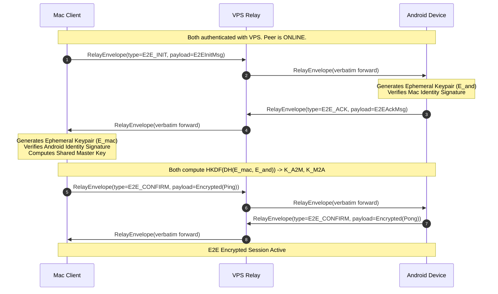

# PhoneLink — Transport & Session Protocol Specification

**DAG Node:** `ARCH-2`  
**Version:** 1.0  
**Status:** Approved Specification  
**Depends On:** ARCH-1 (COMPLETE), ARCH-4 (COMPLETE)  
**Blocks:** ARCH-3, AND-5, VPS-3, MAC-2

---

## 1. Executive Summary

PhoneLink enables an Android phone and a macOS client to communicate securely across arbitrary networks using a low-trust VPS relay. This document specifies the transport, authentication handshake, end-to-end (E2E) encryption, session lifecycle, and error-handling semantics.

**Core Invariant:**  
The VPS acts purely as a router of encrypted envelopes. The VPS never terminates E2E encryption and has zero access to private keys or plaintext application payloads (files, directory listings, camera frames, and remote actions).

---

## 2. Multi-Layer Protocol Stack

The PhoneLink protocol consists of three layered abstractions:

```
┌────────────────────────────────────────────────────────┐
│ Layer 3: Application Payload Layer                     │
│ (File operations, camera frames, status, ping/info)     │
│ Plaintext visible ONLY to Android & Mac                │
├────────────────────────────────────────────────────────┤
│ Layer 2: End-to-End (E2E) Encryption Envelope          │
│ AEAD Ciphertext (XChaCha20-Poly1305 / AES-256-GCM)     │
│ Keyed with ephemeral E2E session key                   │
├────────────────────────────────────────────────────────┤
│ Layer 1: Relay Routing Envelope (Protobuf)             │
│ Headers: source_id, target_id, session_id, seq, payload│
│ Inspected by VPS for routing, rate limiting, and stats │
├────────────────────────────────────────────────────────┤
│ Layer 0: Secure Transport                              │
│ WebSocket over TLS 1.3 (WSS)                           │
└────────────────────────────────────────────────────────┘
```

---

## 3. Cryptographic Primitives

To guarantee zero custom cryptography while adhering strictly to high-assurance standards:

1. **Device Identity Signatures:**
   - **Ed25519 (RFC 8032)** / **ECDSA P-256 (FIPS 186-4)**:
   - Used to sign authentication challenges with the VPS and authenticate key-exchange parameters.
   - Private keys reside in Android Keystore / macOS Keychain and are non-exportable.
2. **Key Exchange (E2E Session Establishment):**
   - **X25519 (ECDH over Curve25519 - RFC 7748)**:
   - Forward secrecy via ephemeral-ephemeral Diffie-Hellman exchange (`ECDHE`).
   - Authenticated with static device identity keys to prevent MITM.
3. **Key Derivation Function:**
   - **HKDF-SHA256 (RFC 5869)**:
   - Extracts and expands the shared secret into two directional symmetric keys:
     - $K_{A \to M}$ (Android to Mac encryption key)
     - $K_{M \to A}$ (Mac to Android encryption key)
     - Resumption master keys and nonce salting factors.
4. **Authenticated Symmetric Encryption (AEAD):**
   - **XChaCha20-Poly1305** (256-bit key, 192-bit extended nonce) or **AES-256-GCM** (256-bit key, 96-bit nonce + 64-bit sequence counter).
   - Additional Authenticated Data (`AAD`) binds `session_id`, `sequence_number`, `source_id`, `target_id`, and `timestamp` to each frame.
5. **Transport Security:**
   - **TLS 1.3** mandatory on all WebSocket connections (`wss://`).
   - Server public certificate verified against trusted CA or pinned certificate fingerprint.

---

## 4. Device Identity & Pairing Protocol

### 4.1 Device Identity Generation
- **Android:**
  On first run, the app initializes a cryptographic keypair inside Android Keystore (`DeviceIdentityKey`). A 32-byte unique `device_id` is derived:
  $$\text{device\_id} = \text{HEX}(\text{SHA-256}(\text{IdentityPublicKey}))$$
- **Mac:**
  On first run, the CLI initializes `MacIdentityKey` in the macOS Keychain. The `device_id` is derived identically.

### 4.2 Out-of-Band Pairing Ceremony (QR Code / Short Code)
Pairing establishes mutual authorization between the single Android phone and single Mac computer:

```
Mac CLI                                                        Android Device
   │                                                                 │
   │  1. Generates Pairing Request:                                  │
   │     - Mac Device ID                                             │
   │     - Mac Identity Public Key                                   │
   │     - One-Time Pairing Token (128-bit cryptographically random) │
   │     - Expiry: 300 seconds                                       │
   │                                                                 │
   │  2. Renders ANSI Unicode QR Code in terminal                    │
   │     (and displays 8-character alphanumeric short code)          │
   │     ═══════════════════════════════════════════════════►        │
   │                                                                 │
   │                                                      3. Scans QR Code / Enters Code
   │                                                      4. Validates token format
   │                                                      5. Confirms Mac identity fingerprint
   │                                                                 │
   │  6. Both submit Pairing Claim to VPS Relay                     │
   │     (Signed with respective Identity Keys)                      │
   │───────────────────────────────┬─────────────────────────────────│
                                   ▼
                              VPS Relay
                     Verifies signatures & token match.
                     Stores (MacID, AndroidID) pair in registry.
                     Both devices marked mutually authorized.
```

---

## 5. Session Establishment & Handshake Flow

### 5.1 Relay Transport Connection (Client ↔ VPS)
Each client establishes a WebSocket connection to the VPS over TLS 1.3:
1. `Client -> VPS`: HTTP Upgrade to WebSocket (`/ws/v1/connect`).
2. `VPS -> Client`: Sends `AuthChallenge` containing:
   - `server_nonce` (32 random bytes)
   - `timestamp` (Unix epoch seconds)
3. `Client -> VPS`: Sends `AuthResponse` containing:
   - `device_id`
   - `client_nonce` (32 random bytes)
   - `signature = Ed25519_Sign(IdentityPrivKey, server_nonce || client_nonce || timestamp)`
4. `VPS`:
   - Checks that `timestamp` is within 30 seconds of server clock (clock-skew check).
   - Looks up `device_id` in authorized registry.
   - Verifies `signature` using registered `IdentityPublicKey`.
   - Checks and records `server_nonce` to prevent replay.
   - Returns `AuthSuccess` with:
     - `session_token` (signed JWT or HMAC-SHA256 token valid for max 24h)
     - `peer_status` (`OFFLINE` or `ONLINE`)
5. If the paired peer is already connected, the VPS emits `PeerConnectedEvent` to both endpoints.

### 5.2 End-to-End Session Handshake (Mac ↔ Android via VPS)

Once both devices are connected to the VPS, they negotiate an E2E session key. The VPS relays these messages verbatim without understanding their contents:



**Cryptographic Details of E2E Handshake:**
- `E2EInitMsg`:
  - `eph_pubkey_mac` (32-byte X25519 public key)
  - `timestamp` (epoch seconds)
  - `mac_identity_sig = Sign(MacIdentityPrivKey, eph_pubkey_mac || timestamp)`
- `E2EAckMsg`:
  - `eph_pubkey_android` (32-byte X25519 public key)
  - `timestamp` (epoch seconds)
  - `android_identity_sig = Sign(AndroidIdentityPrivKey, eph_pubkey_android || eph_pubkey_mac || timestamp)`
- **Key Derivation:**
  $$SS = \text{X25519}(EphPriv, EphPub)$$
  $$PRK = \text{HKDF-Extract}(\text{salt}=\text{timestamp}, IKM=SS)$$
  $$K_{M \to A} = \text{HKDF-Expand}(PRK, \text{"PhoneLink-M2A-v1"}, 32)$$
  $$K_{A \to M} = \text{HKDF-Expand}(PRK, \text{"PhoneLink-A2M-v1"}, 32)$$

---

## 6. Packet Framing & Wire Format

Every transmission across the WebSocket is a binary Protobuf frame.

### 6.1 Outer Relay Frame (`RelayEnvelope`)
```protobuf
syntax = "proto3";
package phonelink.relay;

message RelayEnvelope {
  uint32 version = 1;          // Protocol version (1)
  string source_id = 2;        // Source device ID (HEX)
  string target_id = 3;        // Destination device ID (HEX)
  string session_id = 4;       // Active session identifier
  uint64 sequence_number = 5;  // Monotonically increasing sequence number
  int64 timestamp = 6;         // Epoch timestamp (milliseconds)
  PayloadType type = 7;        // Envelope type
  bytes payload = 8;           // Opaque ciphertext for app messages, or control payload
}

enum PayloadType {
  PAYLOAD_TYPE_UNSPECIFIED = 0;
  CONTROL_PING = 1;
  CONTROL_PONG = 2;
  CONTROL_STATUS = 3;
  CONTROL_RESUME = 4;
  E2E_HANDSHAKE_INIT = 10;
  E2E_HANDSHAKE_ACK = 11;
  E2E_APPLICATION_DATA = 20;   // Encrypted payload
}
```

### 6.2 Encrypted Application Container (`EncryptedPayload`)
When `type == E2E_APPLICATION_DATA`, `payload` bytes contain:
```
┌──────────────────────────┬──────────────────────────┬──────────────────────────┐
│ Nonce / IV (12 or 24 B)  │ Ciphertext (N Bytes)     │ Auth Tag (16 Bytes)      │
└──────────────────────────┴──────────────────────────┴──────────────────────────┘
```
**Additional Authenticated Data (`AAD`) Input:**
$$\text{AAD} = \text{version} \mathbin{\Vert} \text{session\_id} \mathbin{\Vert} \text{sequence\_number} \mathbin{\Vert} \text{source\_id} \mathbin{\Vert} \text{target\_id}$$
This guarantees that an attacker or rogue VPS cannot alter routing fields, splice replay messages, or redirect frames without failing authentication tag validation.

---

## 7. Reconnection & Session Resumption

### 7.1 Resumption Protocol
When an endpoint drops due to network handoff (e.g. Wi-Fi to cellular) or temporary packet loss:
1. The client retains its active E2E symmetric keys and current sequence counters for up to 60 seconds.
2. Upon reconnecting to the VPS, the client transmits `CONTROL_RESUME` containing:
   - `session_id`
   - `last_received_seq`
   - `resumption_token` (derived during handshake via HKDF)
3. If the VPS still has the pairing active and the token matches within the 60-second window, the connection resumes immediately without a full TLS or E2E handshake.
4. If resumption fails (expired or invalid), both endpoints execute a clean reset and initiate a fresh E2E handshake.

### 7.2 Exponential Backoff Strategy
- Initial retry: $500\text{ ms} \pm 20\%$ jitter.
- Multiplier: $2.0$.
- Maximum backoff: $30\text{ seconds}$.
- Reset backoff counter after 60 seconds of stable connection.

---

## 8. Security & Failure Handling

| Failure / Scenario | Protocol Behavior |
|--------------------|-------------------|
| **Invalid Client Signature** | VPS closes WebSocket immediately (`CloseCode: 4401 Unauthorized`). |
| **Out-of-Order / Replayed Message** | Rejected by receiving endpoint based on sliding sequence window (size 64). |
| **Auth Tag Failure** | Ciphertext discarded immediately. An error alert is triggered; session terminated if repeated. |
| **Peer Offline during Request** | VPS immediately returns `RelayError(CODE_PEER_OFFLINE)` to caller. Requests are never silently queued. |
| **Device Revocation** | When `phonelink revoke` is processed, VPS drops active sockets and blacklists the public key immediately. |
| **Message Size Exceeded** | VPS drops messages $> 10\text{ MB}$ (chunked file transfer uses $1\text{ MB}$ max per chunk). |

---

*This specification is binding for ARCH-3 (schema generation) and all client/relay implementations.*
